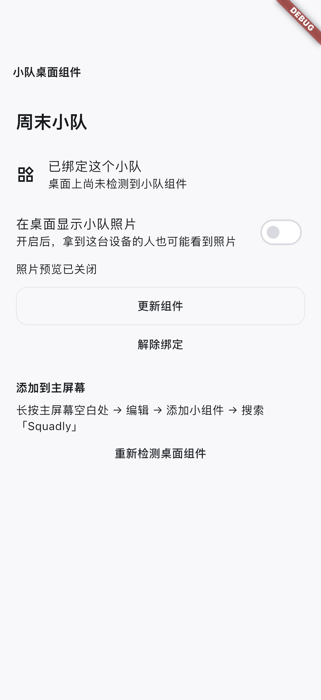
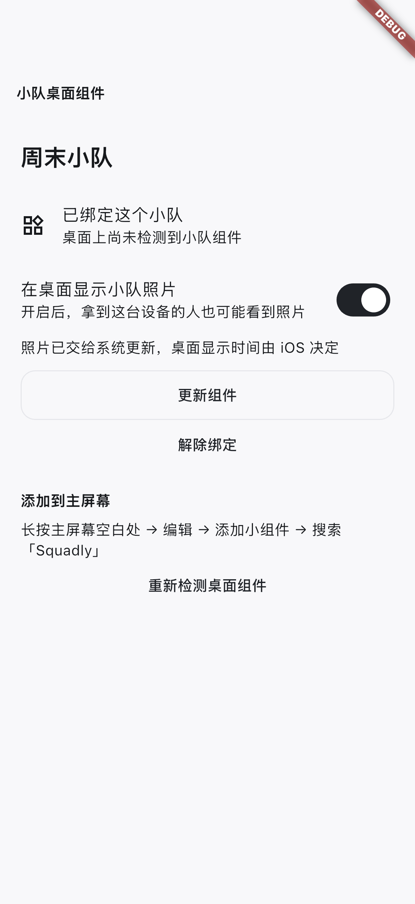
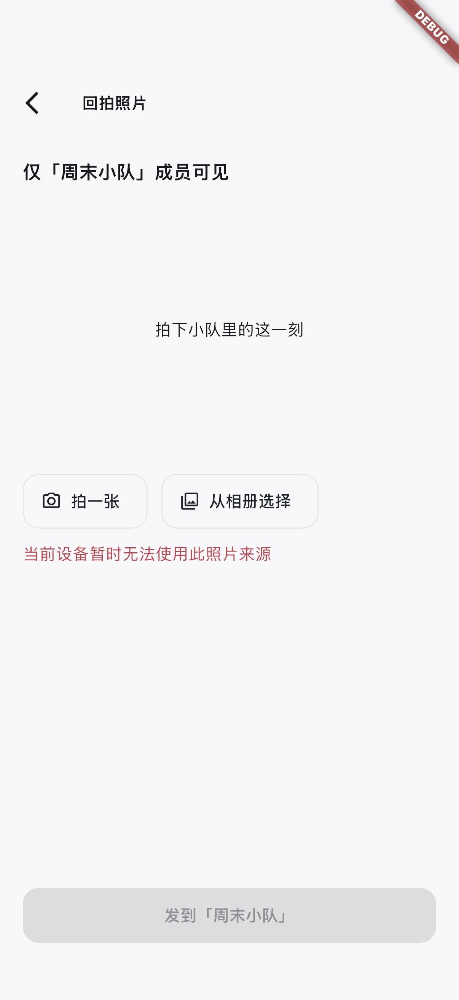

# iOS 小组件本地与 staging 检查点

2026-10-28，iPhone 17 Pro Simulator / iOS 26.5。当前是 A5 本地实现证据；A5 整体、A7 后台触达均未验收完成。

## 已通过

- `bash scripts/verify_all.sh` 全部本地检查通过（含 WidgetCore、真实模式专项、Node 与 SQL）；远端 CI 尚未执行。
- Flutter 全量：550 通过、3 跳过；根工程与独立宿主 analyze 无问题。通用 iOS 集成批次 5 通过、13 跳过；需显式启用的组件/照片 UI 等单独记录，未将跳过项计作通过。
- Swift WidgetCore：9 项通过，覆盖默认隐藏、15 分钟/会话上限、时钟变化、账号/环境、重绑、关闭再开启后的迟到下载、失败清图与损坏文件。
- 真实 iOS bridge：1 项通过。实际使用 App Group、原生 JPEG 缩略图、WidgetCenter 配置查询；验证默认隐藏、会话到期、换账号及旧代次写入拒绝。使用合成账号/图像，无云端媒体请求。
- 模拟器 UI：1 项通过，下面 3 张截图已逐张检查。设置页区分“已绑定”和“系统尚未添加”，默认不开照片；固定入口保留原队和父消息，自动调用实际系统相机接口，模拟器返回不可用。发送仍需用户选择/预览/确认，未自动发布。
- iOS debug 模拟器真实模式构建、无签名设备构建均通过；主 App/测试宿主各自嵌入 WidgetKit 扩展，App Group 和 URL scheme 隔离。工程配置脚本重复执行无变化。
- 本地 PostgreSQL 顺序重放 17 个 migration 与权限反例通过：照片过滤分页、完整游标、海量文字、跨队/非成员/离队、撤回后不可查询、匿名 EXECUTE 拒绝。
- staging 第 17 个迁移 `20261028000100_photo_timeline_queries.sql` 部署成功，任务 `task-f242dd7906124b5f` 为 Succeed；CLI list 本地/远端 17/17，最终 dry-run 无待执行项。部署不等于普通用户 RLS 验收。

## 截图





## 复现

仓库根目录：

```sh
flutter analyze
flutter test
bash scripts/test_ios_widget_bridge.sh
bash scripts/check_cloudbase_migrations.sh
flutter build ios --simulator --debug --dart-define-from-file=config/test-backend.local.env
flutter build ios --debug --no-codesign
```

独立 `integration_test/` 目录，使用同一已启动模拟器：

```sh
flutter test integration_test/photo_widget_bridge_test.dart -d <simulator-id> --no-uninstall --dart-define=VERIFY_PHOTO_WIDGET_SIMULATOR=true --dart-define=SQUADLY_WIDGET_URL_SCHEME=squadly-test
flutter drive -d <simulator-id> --driver=test_driver/photo_ui_driver.dart --target=integration_test/photo_widget_ui_test.dart --dart-define=VERIFY_PHOTO_WIDGET_UI_SIMULATOR=true --dart-define=USE_DEMO_BACKEND=true --dart-define=SQUADLY_WIDGET_URL_SCHEME=squadly-test
```

最新 staging 模拟器包已安装并启动到 A/B 两台现有验收 App，保留原数据；安装不代表已重新登录。

真实模式 public 配置为 git-ignored 本地文件。CI 已加入 Swift、原生 App Group 和 UI 截图步骤，尚未运行远端 workflow。机器可复核摘要见 [verification.json](verification.json)。

## 尚待通过

1. Mac 当前锁屏，原生 UI 工具不能访问 SpringBoard。需要解锁后实际添加小/中组件，检查正常、隐藏、过期、重绑及冷启动系统链接；不能把当前三张 App 内截图算成桌面绘制证据。
2. A/B 尚无有效新 SDK 登录会话；按用户选择在现有验收 App 重新登录，再做普通用户上传/读取/撤回、照片 RPC 与私有对象允许/拒绝验证；第三账号 C 仍待准备。
3. Apple 开发者 App Group provisioning、真机签名、锁屏/重启后的文件保护和系统快照残留/时延。
4. A7 APNs 事件、后台受限获取与实际绘制。当前只接前台/恢复前台更新及 App 已知发送/撤回后的更新，不宣称后台可达或按秒刷新。
