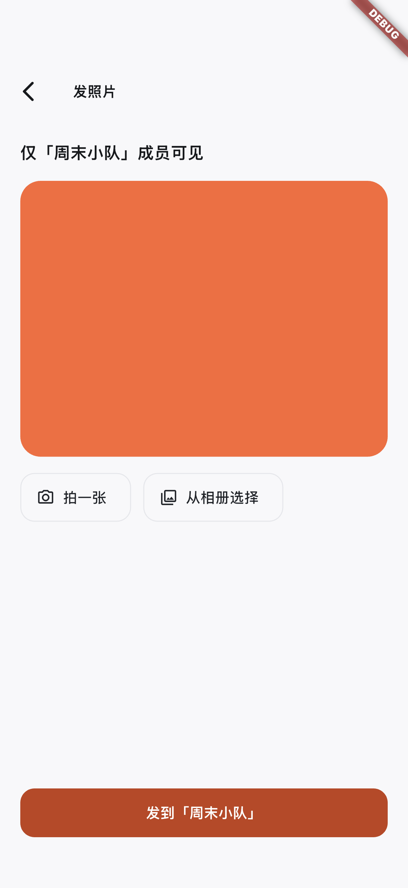
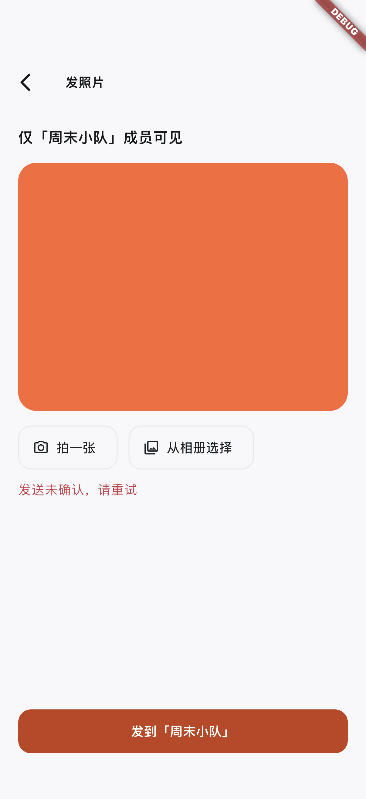
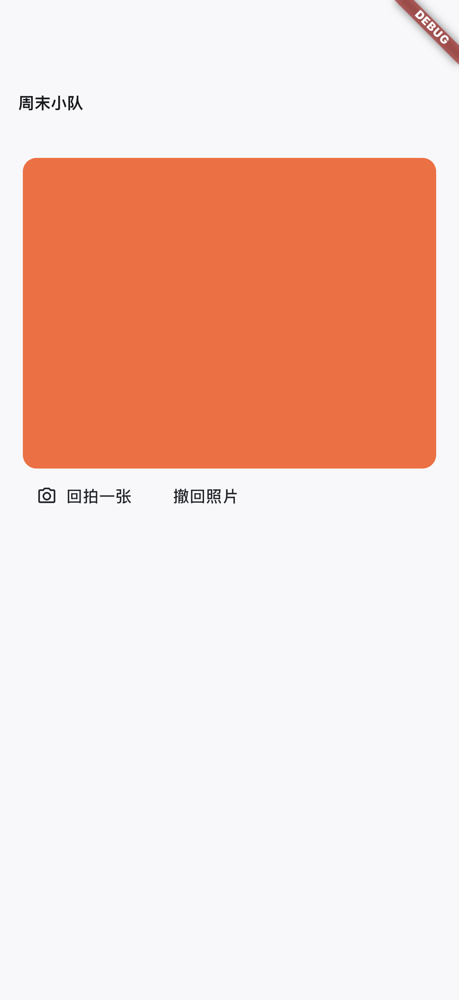
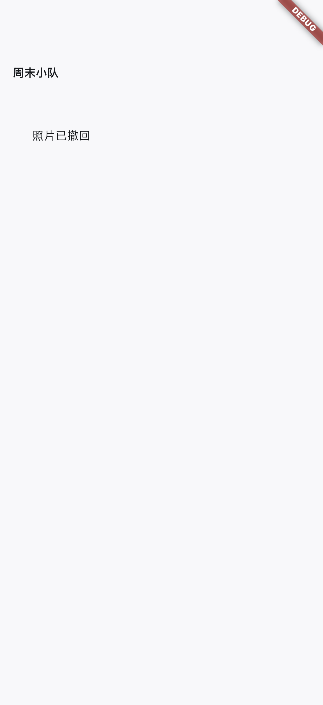

# iOS 照片 UI 验证：2026-10-27

设备：iPhone 17 Pro 模拟器 / iOS 26.5，debug 构建。测试 `integration_test/integration_test/photo_ui_test.dart` 的 1 项业务流程通过，截图由 Flutter integration driver 从真实模拟器获取，未改图；已逐张检查。橙色块是合成 4 × 3 JPEG，不是个人照片。

验证范围：真实原生相机不可用状态、固定小队预览、明确确认后调用发送、失败保留同一 nonce 重试、照片展示和作者确认撤回后的墓碑。相册来源与媒体 repository 是测试替身；未验证实际系统相册点选、真机相机、CloudBase 用户媒体读写、WidgetKit/APNs 或跨设备链路。截图中的消息展示是组件测试场景，不是完整会话页面。

| 预览确认 | 发送未确认，可重试 |
| --- | --- |
|  |  |

| 照片展示和回拍入口 | 撤回墓碑 |
| --- | --- |
|  |  |

从 `integration_test/` 执行：

```bash
flutter pub get
flutter drive -d <ios-simulator-id> \
  --driver=test_driver/photo_ui_driver.dart \
  --target=integration_test/photo_ui_test.dart \
  --dart-define=VERIFY_PHOTO_UI_SIMULATOR=true
```

驱动将合成场景截图写入 `/tmp/squadly-photo-ui-device/`。该用例只在 iOS 模拟器运行，不能作为真机相机不可用的预期。iOS 真机需另做相机/系统选图验收。

[机器可读记录与图片摘要](verification.json) · [完整实施台账](../../ios-photo-loop.md)
