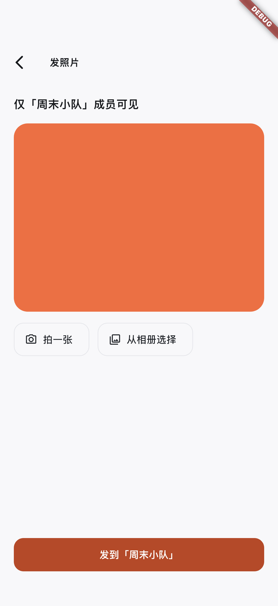
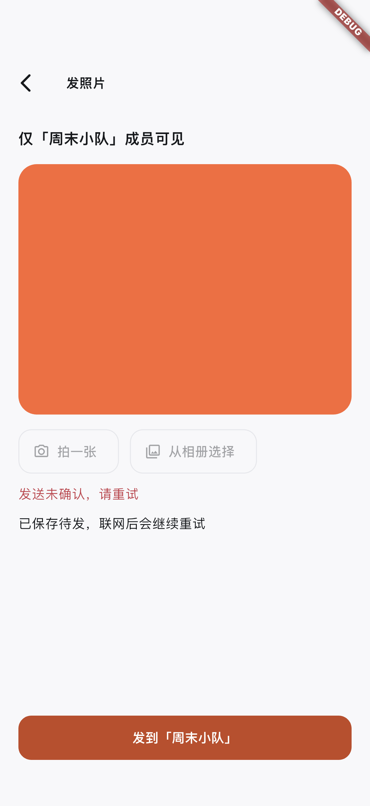
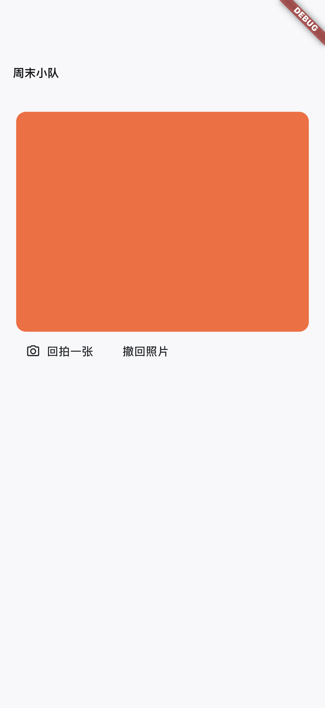
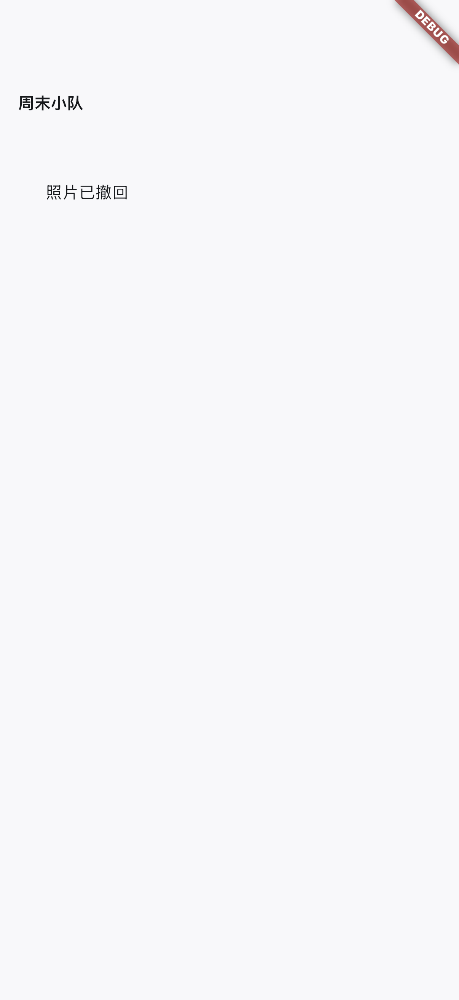

# iOS 加密照片待发验证：2026-10-28

本轮完成 A4 的本地与模拟器持久化切片，整体照片三环尚未完成。设备为 iPhone 17 Pro / iOS 26.5 模拟器，测试宿主包名 `com.example.squadlyIntegrationTest`，与真实验收 App 分开。

验证结果：Flutter 521 项通过、3 项跳过；真实模式专项 14 项通过；根项目/独立宿主分析与 `verify_all.sh` 通过。新增 27 项本地验证涵盖固定旧密文兼容、v3 照片加密、身份/内容篡改、相同 nonce 冲突、提交后响应丢失、账号/队伍/计划隔离、各异步阶段退出、并发重试和保存未确认状态。

原生跨进程 **2 项通过**：seed 在真正的 SQLite/Keychain 保存确认照片；read 在不同进程 ID 下恢复相同 JPEG、nonce、队伍和父消息。另一账号不会重放原账号记录；原账号确认后，只清除其本人的待发。媒体及时间线 transport 是测试替身，网络被禁止；这不证明真实 CloudBase 用户媒体权限或云端响应丢失路径。

从 `integration_test/` 顺序运行，两次均需 `--no-uninstall`，防止 Flutter 在结束时卸载宿主并删除 SQLite/偏好设置：

```bash
flutter pub get
flutter test integration_test/photo_outbox_cold_start_test.dart \
  -d <ios-device-id> --no-uninstall \
  --dart-define=RUN_PHOTO_OUTBOX_NATIVE=true \
  --dart-define=PHOTO_OUTBOX_PHASE=seed
flutter test integration_test/photo_outbox_cold_start_test.dart \
  -d <ios-device-id> --no-uninstall \
  --dart-define=RUN_PHOTO_OUTBOX_NATIVE=true \
  --dart-define=PHOTO_OUTBOX_PHASE=read
```

首次不带保留参数的 read 失败，因为测试工具已卸载宿主；不计通过。之后带参数的两次进程启动均通过，未用复制数据库文件或内存 fake 替代恢复。

新版 UI 流程 **1 项通过**，截图从真实模拟器取得，未修图，已逐张检查。橙色块是合成 JPEG。截图中的消息展示是组件测试场景，不是完整会话页面；相册来源和媒体 API 使用测试替身。确认后锁定当前图，已保存待发与保存未确认分别显示；重试不换 nonce。

| 未确认预览 | 已确认且保留待发 |
| --- | --- |
|  |  |

| 消息照片与回拍入口 | 撤回墓碑 |
| --- | --- |
|  |  |

UI 用例仅在 iOS 模拟器开启：

```bash
flutter drive -d <ios-simulator-id> \
  --driver=test_driver/photo_ui_driver.dart \
  --target=integration_test/photo_ui_test.dart \
  --dart-define=VERIFY_PHOTO_UI_SIMULATOR=true
```

CI 已配置 seed/read、UI 截图及截图产物上传，未验证远端 run。与 CI 相同的通用 iOS 集成命令本地 **5 通过、11 按平台/开关跳过**，含 2 个原生照片 bridge 用例；原生队列/UI 的 opt-in 专测结果独立列在上方。真实模式 iOS 模拟器构建成功。实际系统相册点选、真机相机、CloudBase A/B/C 媒体权限、签名/APNs、WidgetKit、Android、连续天数与周回顾仍待后续阶段。

[机器可读结果与截图摘要](verification.json) · [完整实施台账](../../ios-photo-loop.md)
