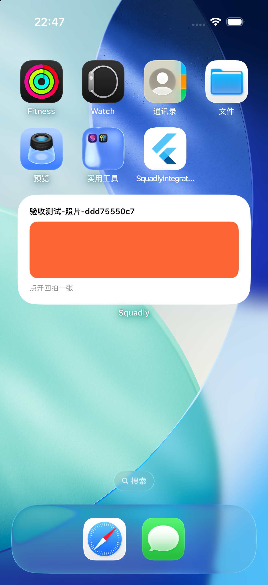
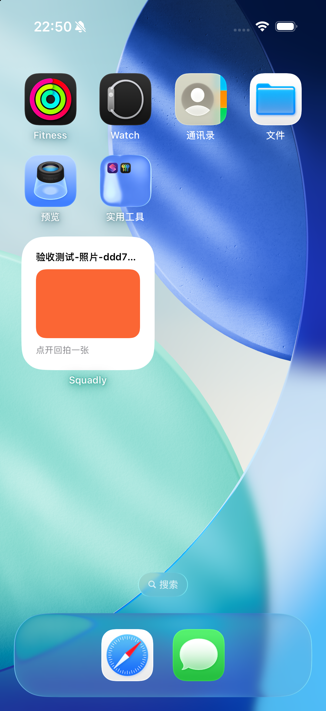

# Squadly 操作与测试手册

更新：2026-10-31（Asia/Shanghai）。适用于本机已安装的 iOS staging 验收 App。先用本手册体验；范围见[规格书](squadly-product-spec-2026-10-31.md)，通过证据见[完成情况](squadly-feature-status-2026-10-31.md)。

## 1. 验收 App 在哪里，怎么打开

**它在 Xcode 的 iPhone 模拟器里，不是 Mac 原生 Squadly，也不是 TestFlight。** 当前 Xcode 的模拟器窗口由 **Device Hub** 管理。

| 对象 | 当前设备 / 标识 | 用途 |
| --- | --- | --- |
| A | iPhone 17 Pro，iOS 26.5 | 已有 A 账号，当前测试队中为队长 |
| B | iPhone 17，iOS 26.5 | 已有 B 账号，当前测试队中为成员 |
| Squadly | bundle `com.squadly.squadly` | 你需要手工体验的真实根 App |
| Squadly Integration Test | bundle `com.example.squadlyIntegrationTest` | 自动化宿主，不是日常验收 App；数据/组件组与根 App 分开 |

在终端执行以下两行，即可打开现有 A/B App，不重装、不清数据、不需要重新输入配置：

```bash
cd /Users/haiming/workspace/dev-apps/squadly
bash scripts/ios/open_acceptance_apps.sh all
```

只打开一台时，把 `all` 换成 `a` 或 `b`。脚本只定位本机这两台已知设备，检查已安装后启动；不会登录新账号或替你创建云端数据。

打开后用 Mac 顶部 **Device Hub → Window → iPhone 17 Pro / iPhone 17** 切窗口。窗口下方九宫格 **Home** 返回模拟器主屏幕。用鼠标点击手机画面、拖动滚动，输入框可以用 Mac 键盘输入。组件已经位于两台设备的第二页主屏幕；左右拖动切页。点击照片区域更容易命中回拍入口。

如果应用停在先前的页面，它可能只是恢复了原进程。需要普通冷启动时，可以先保留已确认的待发内容，再执行对应设备的 terminate/launch：

```bash
xcrun simctl terminate 370493B7-843A-47ED-AE82-7CB75E21691E com.squadly.squadly
xcrun simctl launch 370493B7-843A-47ED-AE82-7CB75E21691E com.squadly.squadly
```

以上为 A；B 的设备 ID 是 `DA33717A-0E70-4727-8623-A22CED1A5432`。terminate 不等于卸载，但尚未确认的内存预览可能丢失。不要用卸载/抹除模拟器作为普通刷新方式。

## 2. 账号、模式和测试数据

- A/B 是验收角色标签，不是登录名或密码。当前两台普通启动均恢复了现有真实 staging 账号；若进入登录页，使用自己已有的对应账号，不要反复注册或把密码/token 发进聊天。
- 当前验收环境为固定 CloudBase staging；两台联网访问相同服务端数据。C 为从未加入指定队的反例账号，不在这两台日常 App 中切换使用。
- **Demo 只适合界面与本地规则体验**，不验证真实分享、RLS、照片存储或推送。不要用默认 Demo 构建覆盖当前 A/B 来判断云端是否正常。
- `验收测试-照片-ddd75550c7` 是现有共享合成照片队；橙色矩形是 4×3 合成 JPEG 放大后的预期画面，不是加载失败。保留此照片供后续自动化使用，不要在这个队里做撤回/隐藏/举报破坏性测试。
- `验收测试-照片未入队C-d32ec52f0a` 是权限反例队，当前照片已撤回，显示空状态正常；不是有图队。两台都能看到队名不代表 C 有权访问。
- 新的发送、撤回、隐藏、举报与离队测试，请新建以 `手工验收-日期-用途` 命名的独立小队，用纯色或无个人信息图片。A 建队、B 用邀请码加入；对该小队的处理不要影响其他真实数据。

## 3. 建议先做的 10 分钟体验

**先验证模拟器真实联网**，不要只看Wi-Fi图标或宿主机curl：

```bash
python3 scripts/ios/check_simulator_network.py --config config/test-backend.local.env --device all
```

此命令在两台已启动模拟器内部执行URLSession：Apple HTTPS应200，无登录材料的CloudBase身份接口应401（表示服务可达），照片服务GET应405（表示路由可达）。它不使用账号凭据，不证明实际照片已送达。2026-10-31已在A/B实跑通过。大图原先报错的原因是HTTP413文本请求大小限制，并非模拟器断网，修复及复验证据见[上传传输合同](../modules/photos/upload-transport.md)。

1. 打开 A/B。先在「我的」核对两台是不同账号，再回「小队」。
2. 在「我的小队」选 `验收测试-照片-ddd75550c7`。队列表在页面下方，向下滚动；不要把页面顶部队名当作切队菜单。
3. 进入「小队桌面组件」。若尚未绑定，点「绑定这个小队」或「改为绑定这个小队」；换绑后预览应为关闭。
4. 开启「在桌面显示小队照片」，或在已开启时点「更新组件」。等待状态变为“照片已交给系统更新”。这一步有网络请求，勿连续重复点。
5. 用模拟器 Home 返回第二页主屏幕。A 中尺寸和 B 小尺寸应出现橙色照片，底部“点开回拍一张”。
6. 点击照片区域，应进入「回拍照片」，受众仍为上述队；没有让你重新选队/选人。
7. 模拟器没有真实相机时，“当前设备暂时无法使用此照片来源”是预期。点「从相册选择」继续；若只看入口，可以到此结束，不必发新照片。
8. 到「计划」创建一个独立测试计划，添加一个任务再勾选，核对进度与完成状态；不要修改已有真实计划。

这段体验检验 App 与前台组件交互，不检验 APNs 自动触达。现在不能用“等 B 不打开 App 看是否更新”作为应当必过的功能。

## 4. 如何给模拟器相册放测试图片

模拟器没有你的 iPhone 相册。可以从系统照片中选择已有测试图片，也可以把准备好的合成图片导入对应模拟器。导入是本机操作，不直接发给小队；发到云端仍需 App 里确认。

```bash
xcrun simctl addmedia 370493B7-843A-47ED-AE82-7CB75E21691E /absolute/path/test-photo.jpg
xcrun simctl addmedia DA33717A-0E70-4727-8623-A22CED1A5432 /absolute/path/test-reply.jpg
```

把示例绝对路径换成实际文件，两台最好用不同颜色方便区分。App 中「从相册选择」会打开系统选择器；取消应回预览页且不发布。真机测试再使用实际相机，模拟器相机失败不能证明真机拒权路径已通过。

## 5. 各入口如何操作

| 目标 | 操作路径 | 要核对的结果 |
| --- | --- | --- |
| 创建/加入小队 | 小队 → 创建小队 / 加入小队；队长生成邀请码/链接 | 两人进入同一队，成员身份正确；邀请失败有中文提示 |
| 切队 | 小队 → 向下滚动 → 我的小队 → 点队名 | 当前队明确变化；既有组件仍保持原绑定，直到主动重绑 |
| 发文字 | 会话 → 目标小队 → 输入文字 → 发送 | B 在同队刷新查看；计划讨论不混入普通队线程 |
| 发照片 | 同队会话 →「发照片」相机图标 → 拍摄/选图 → 预览 →「发到队名」 | 未确认不出现消息；发送后会话可查看；失败区分待发与未确认 |
| 回拍/文字回复 | 队友照片 →「回拍一张」；文字回复使用消息回复入口 | 回拍页标题正确、目标固定，父消息关系保留 |
| 自己撤回 | 自己照片 →「撤回照片」→ 确认 | 出现墓碑，B 后续刷新/读取不能继续获取原图 |
| 仅自己隐藏 | 队友照片 →「照片选项」→「隐藏照片」→ 确认 | 本人显示隐藏，作者仍能看；不要用保留夹具练习 |
| 举报 | 队友照片 →「举报照片」→ 原因 → 确认举报并隐藏 | 提交结果明确；不能据此断言人工审核已完成 |
| 组件设置 | 小队 → 目标队 → 小队桌面组件 | 检测到实例数、绑定状态、预览开关；关闭后实际桌面应隐藏 |
| 添加组件 | 长按主屏幕空白处 → 编辑 → 添加小组件 → 搜索 Squadly → 选择尺寸 → 添加 | 在桌面真实出现；教程打开不算添加成功；多个实例共用一个绑定 |
| 新建计划 | 计划 → 创建/模板 → 填名称类型 → 下一步设置受众/日期 → 保存 | 标题/日期/原 Squad 正确；模板不生成虚构任务 |
| 计划任务/讨论 | 计划详情 → 添加任务 / 进入计划讨论 | 负责人/截止时间正确；任务进度来自真实任务；讨论独立 |
| 数据工坊 | 我的 → 数据工坊 → 选择/导入素材 → 制作分享 → 确认 | 仅一次静态快照；敏感字段默认不选，受众明确，不持续同步 |
| 本机记录/外观 | 我的 → 本机聊天记录 / 清理本机聊天记录 / 外观 | 清理范围按弹窗；主题重启保留；清理历史不等于撤回服务器内容 |
| 通知与帮助 | 我的 → 通知设置 / 使用帮助 | 当前渠道未完整配置；系统允许通知不等于 APNs 已送达 |

健身/理财/旅行/美食的既有业务入口在「计划」的相应场景入口；计划类别模板只是统一计划，不是该业务的全部页面。不要把测试资产或健康数值当作真实建议。

## 6. 一次照片往返的手工验收单

以下应在新建的双账号测试队操作；每行按实际结果记通过/失败/阻塞，未执行不要写通过。

| ID | 动作 | 预期 / 判定 |
| --- | --- | --- |
| T01 | A 建队，B 使用邀请码加入 | 两人同队；非邀请入口不能任意加入 |
| T02 | 两端绑定组件但不开预览 | 桌面隐藏照片；重绑不沿用旧图 |
| T03 | A 选图后取消 | 无新消息、无队友可见照片 |
| T04 | A 选图、预览、确认发送 | 一条照片消息；显示队名；无重复发送 |
| T05 | B 打开同队会话/显式刷新 | 实际取到 A 照片。当前可先用回到列表再进入方式补取，不要求所有会话实时推送 |
| T06 | B 开预览或更新组件，回 Home | 小组件实际出现照片，不能仅记 App 内“交给系统” |
| T07 | B 点组件，系统相册选择另一图并确认 | 原队关联回拍，A 后续刷新可看到 B 的回拍 |
| T08 | App 当前选择另一队，再点原组件 | 仍进入绑定队；禁止误发到当前选中队 |
| T09 | B 关闭预览，再回 Home | 桌面不再显示照片；记录实际刷新时间和残留，不把缓存清理当绘制证据 |
| T10 | A 在独立测试队撤回测试照片，B 再读取 | 撤回墓碑，原图后续读取失败；已保存截图不保证回收 |
| T11 | B 隐藏/举报另一张测试照片 | B 不再看，A 可看；举报没有泄露给其他队员 |
| T12 | 发送时断网，再联网或重启 App | 已确认待发仍属原账号/原队；恢复不重复；先记录未发送状态 |
| T13 | 建立自己可见计划，B 查看同队 | B 不应看到 A 的私密计划/任务；共享计划可看 |
| T14 | 新建测试私密资产/素材，切到 B | B 不应读到；队长身份也不例外。不要使用真实资产数值 |
| T15 | B 后台/关闭 App，A 发照片 | **当前平台触达待验，可能阻塞**；不要修改系统时间或注入假通知后宣称 APNs 成功 |

T07 的实际系统选图往返、T09 的全部桌面状态、T12 的真实断网场景仍应由这次手工执行补证，不因自动化已有部分覆盖而预填通过。强退、锁屏、重启、自然会话到期与网络恢复还需签名真机分别测试。

## 7. 反馈问题时记什么

记录：时间与时区、设备型号/iOS、A 或 B、测试队的非敏感别名、进入路径、前台/后台/进程终止、网络、预览开关、期望、实际、截图。写清最后成功的一步，例如“App 已显示照片，Home 组件仍是隐藏”。

```text
用例：T06
时间：YYYY-MM-DD HH:mm，Asia/Shanghai
设备：A / B；iOS 版本：
App 模式：staging / Demo
前置：两人已入队，预览已开启，使用合成图
操作：
期望：
实际：
结果：通过 / 失败 / 阻塞
截图或本机日志路径：
```

不要附密码、验证码、JWT/refresh token、配置文件全文、真实健康/资产/精确路线。截图若有私人聊天先打码，优先只用合成测试队。

## 8. 常见现象与处理

| 现象 | 判断与处理 |
| --- | --- |
| 找不到 App | 用第 1 节启动脚本；在 Device Hub Window 切设备，别打开 Integration Test。当前没有 TestFlight 链接 |
| 回拍页没有返回首页入口 | 当前从组件作为根路由进入时可能无返回按钮；用 Home 离开。确需回普通首页，可按第 1 节终止再启动；这是待完善的导航体验 |
| 橙色纯色图 | 当前保留的合成夹具，正常；真照片需自己在测试队确认发送 |
| 小队还没有照片 | 先核对队名；权限反例队照片已撤回。不要直接判断上传失败 |
| 预览已隐藏 | 在正确队的组件设置开启；切换队不等于重绑，重绑会默认关闭 |
| 打开 App 更新照片 | 组件副本到期，最多 15 分钟且受会话期限约束；联网重新验权/刷新。不是永久相册 |
| 照片暂不可用/需联网 | 检查会话/网络/成员资格；撤回或隐藏不能靠重试越权恢复；App 内图片短期副本最多 1 分钟 |
| A 发了 B 组件没自动变 | APNs 未实际接通；先在 B 前台显式更新。记录自动触达为待验，不把系统通知开关当修复 |
| 没有已读或错误报告开关不可用 | 已读默认关；错误上报没有可用 DSN 时不上传。不是必然的 UI 故障 |
| 登录回到首页后仍异常 | 记录操作与安全错误提示；不要运行外部 refresh 工具与 App 并发轮换同一 A/B 会话 |

## 9. 开发者如何复测

当前已安装包优先用于交互。需要重建真实 staging 根 App 时，在仓库根目录执行；本机忽略配置仅含允许进入客户端的公开参数，不要填写服务端 Key：

```bash
flutter pub get
flutter build ios --simulator --debug --dart-define-from-file=config/test-backend.local.env
xcrun simctl install 370493B7-843A-47ED-AE82-7CB75E21691E build/ios/iphonesimulator/Runner.app
xcrun simctl launch 370493B7-843A-47ED-AE82-7CB75E21691E com.squadly.squadly
```

给 B 安装时只换设备 ID。不先卸载，避免丢会话/草稿。若配置文件不存在，按[根 README](../../README.md)设置公开环境参数，不从文档复制任何高权限凭据。Demo 体验请使用另一台测试模拟器运行 `flutter run -d <device-id> --dart-define=USE_DEMO_BACKEND=true`。

普通本地回归不会访问生产后端：

```bash
flutter analyze
flutter test --no-test-assets
flutter test --no-test-assets --dart-define=USE_DEMO_BACKEND=false test/app/providers/photo_widget_bootstrap_test.dart test/app/real_mode_router_test.dart test/features/auth/presentation/auth_async_state_test.dart test/features/auth/presentation/auth_recovery_state_test.dart
```

设备自动化从独立宿主执行；无需用它手工登录 A/B：

```bash
cd /Users/haiming/workspace/dev-apps/squadly/integration_test
flutter pub get
flutter analyze
flutter test integration_test/app_smoke_test.dart -d 370493B7-843A-47ED-AE82-7CB75E21691E --dart-define=USE_DEMO_BACKEND=true
```

真实云端写入测试需要专门 fixture、0600 本机配置、限定 staging 与清理流程，不能把所有 opt-in 开关随意全开。复跑见[provider 验收合同](../modules/photo-widget/production-provider-acceptance.md)与[后端运行手册](../modules/photos/backend-runbook.md)。`bash scripts/verify_all.sh` 还依赖 disposable PostgreSQL/Docker 与 Android/原生工具链；只动专用测试环境，不重启或清理用户的其他 Docker/Colima 实例。

## 10. 已取得的桌面截图

本日使用普通根 App、真实 staging 和既有合成图；中尺寸 A 与小尺寸 B 已实际显示。详情见[截图与边界记录](../modules/photo-widget/evidence/2026-10-31-desktop-ui.md)。

| A：中尺寸照片 | B：小尺寸照片 |
| --- | --- |
|  |  |

下一步先补真实来源、冷启动与桌面失效状态，再联通签名真机 APNs；照片墙、连续/周回顾与跨平台按[开发测试计划](squadly-development-testing-plan-2026-10-27.md)继续。当前无需为继续前台测试重新注册或重新登录 A/B。
