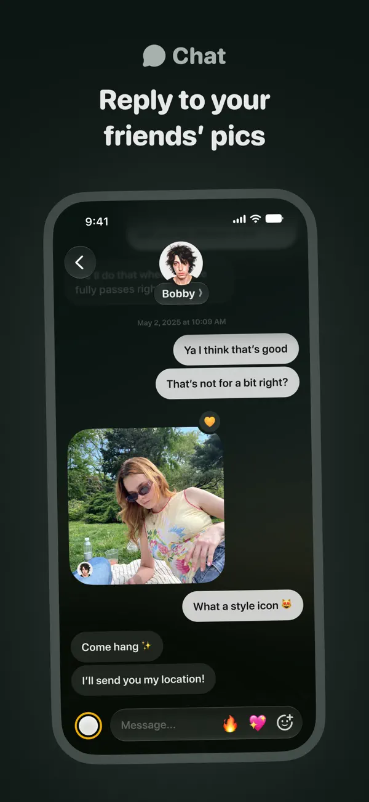
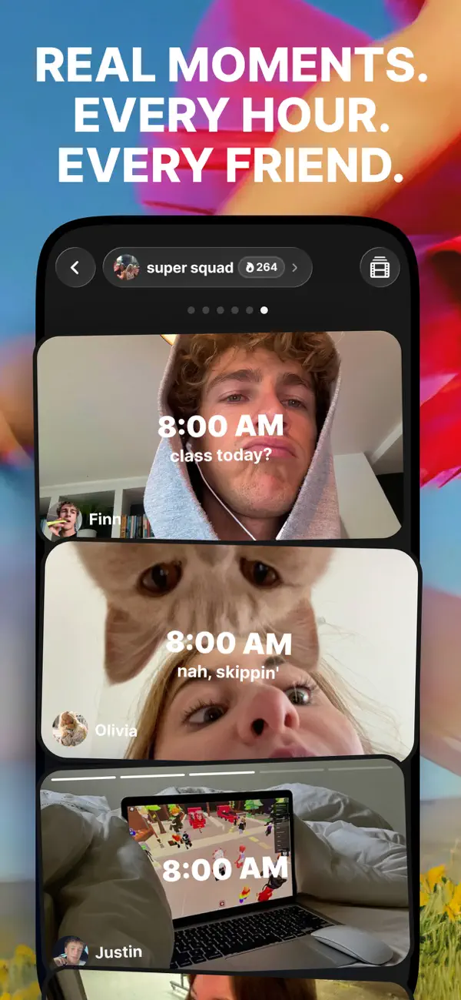
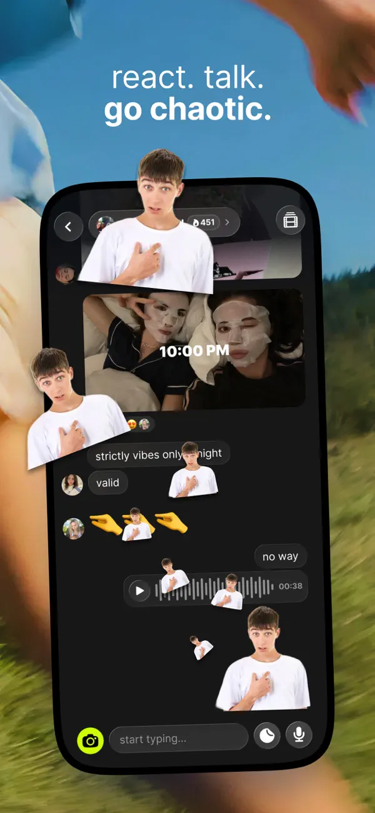
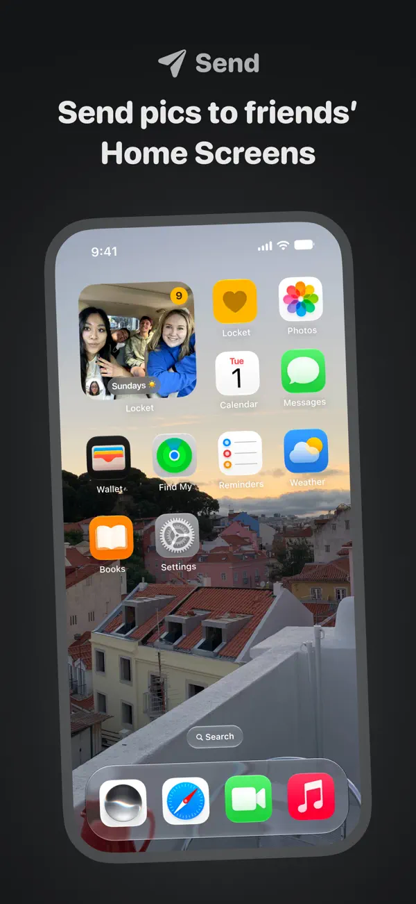
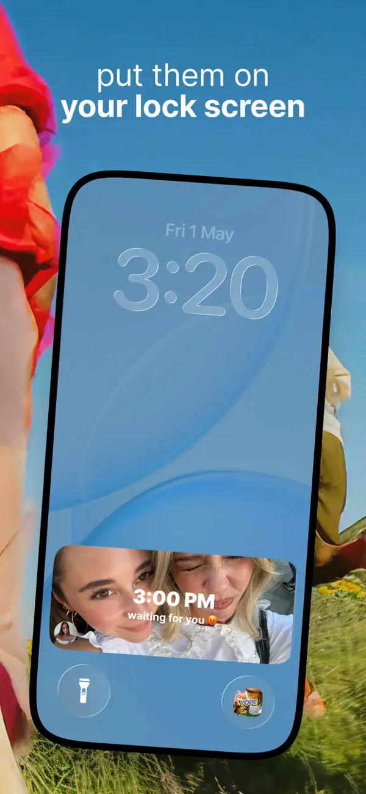
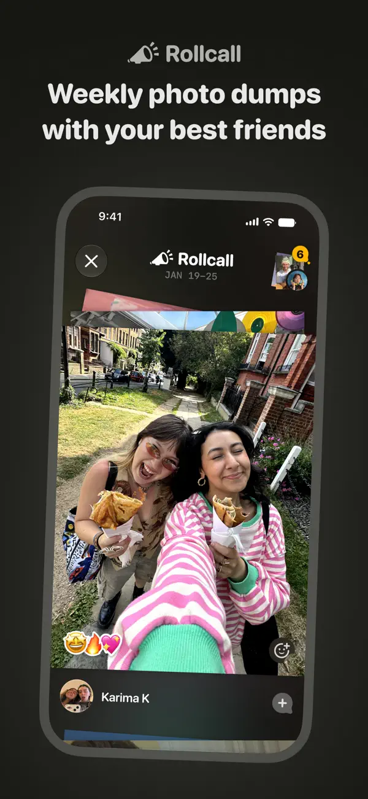

# Squadly 小分队
## 产品设计文档 V1.1

照片三环 · 竞品 UI 参考 · 开发与测试交付

**让最亲近的几个人，出现在彼此的桌面上。**

面向 2-9 人邀请制熟人小队，以照片为第一内容单位：明确发给当前小队，队友在桌面看到照片后进入回拍，照片与回复沉淀为共同记忆。

| 三环 | 用户动作 | 本轮目标 |
| --- | --- | --- |
| 01 触达 | 发照片 → 请求更新队友桌面 | 验证真实设备的 App 外触达 |
| 02 回应 | 点击组件 → 回拍 / 回文字 | 让照片成为下一次对话的起点 |
| 03 沉淀 | 连续出现 → 基础周回顾 | 验证小队关系能否持续七天 |

版本：V1.1 · 更新日期：2026-10-27（Asia/Shanghai）

基于用户提供的 11 页 V1.0 PDF，结合本仓库竞品调研、UI 截图与当前实现完善。保留三环方向，修正证据、优先级和交付边界；不将产品假设写成市场验证结论。

技术基线：Flutter / Riverpod / Material 3 / CloudBase PostgreSQL。

一级导航：会话 / 小队 / 计划 / 我的。

**产品方案不等于上线状态。已有照片来源与净化的局部实现；发送、组件和后台闭环仍待开发与真机验收。**

<!-- page -->
# 01 修订说明与阅读导航

V1.0 已明确照片三环，但缺少视觉参考、实际实现差距和可执行验收。本版将它补成可进入设计与研发拆分的产品方案。

| 本版新增 / 修正 | 阅读位置 |
| --- | --- |
| 保留定位、三环、邀请制与四 Tab，重排 P0/P1 | 第 3-4 页 |
| 发送、受众确认、回拍、异常状态与连续规则 | 第 5-8 页 |
| Squadly 视觉落点 + 8 张竞品官方截图 | 第 9-13 页 |
| 竞品价格、权益、即时刷新等事实修正 | 第 14 页 |
| 媒体权限、缓存、路线与当前代码差距 | 第 15-16 页 |
| 开发顺序、测试矩阵、七天观察和发布门槛 | 第 17-20 页 |
| 原稿改动对照、待定参数与引用来源 | 第 21-22 页 |

## 三类信息必须分清

- **既定约束**：2-9 人、邀请制、角色、四 Tab、PrivateAsset 隔离、路线每卡端到端加密；不因本轮视觉参考而改变。[R1][R2]
- **竞品观察**：官方商店宣传图和帮助说明，仅覆盖可见布局与公开声明；没有登录竞品实机或购买订阅。[R4][R5]
- **本版设计**：照片同源消息、任一成员续天、基础组件免费与交付切片；进入代码前需同步受影响的 F05、UI 规范和数据契约。

## 如何使用

产品与设计先读第 3-15 页；开发按第 16-18 页和任务清单推进；测试按第 19-20 页验收。当前成熟度以源码和最新专项台账为准，不用旧 Phase 勾选框推断已上线。[R3]

<!-- page -->
# 02 产品定义与筛选标准

**定位：小队的共同桌面与照片记忆。** 日常触达可以发生在 App 外，会话承担围绕照片的回应和历史回看；不要求用户为了体验价值先学习健身、理财等多个模块。

| 要素 | 产品规则 |
| --- | --- |
| 人群 | 彼此认识、愿意互发日常照片的 2-9 人小队；首轮优先跑步 / 徒步朋友，再探索伴侣、宿舍与异地家庭 |
| 关系 | 邀请码 / 链接加入；单人建队仅为邀请准备，至少两名成员后才计入激活小队 |
| 内容 | 一张照片是最小分享单位；运动、聚餐、旅行是拍照理由，轻计划提供下次相约的上下文 |
| 体验 | 照片先于统计，明确受众先于发送，不用点赞数、排行和缺卡催促制造竞争 |

## 三条筛选标准改成可验证问题

| 标准 | 本版判定 |
| --- | --- |
| 范围与风险可控 | 不做公域和推荐可减少部分复杂性；照片对象、缓存和内容处置仍需单独设计，不宣称沿用 RLS 即可合规上线 |
| 邀请与往返成立 | 关系产品需要另一位成员参与；验证邀请码兑换、组件添加和不同作者回拍，不能预设邀请链自然增长 |
| 收入不破坏关系 | 竞品有订阅是参考，不能证明 Squadly 的付费转化；先保护免费核心，再测试高级记忆与外观权益 |

本轮不新增：公开搜索、附近的人、陌生人发现、算法推荐、点赞排行、持续健康同步、明文轨迹、AI 亲密陪伴。此处是产品范围，不把竞品所有未知能力写成“没有”。

<!-- page -->
# 03 三环闭环与最小范围

**照片被看到 → 另一位成员回应 → 小队记忆积累 → 再次愿意分享。** 这是待验证的关系循环，不是已经证实的留存因果。

| 环节 | P0 最小交付 | P1 或后续 |
| --- | --- | --- |
| 触达 | 单张照片、相册选图、一个可切换绑定队的免费基础组件、深链相机入口、真实后台更新路径 | 多组件同时展示、高级边框、锁屏特化、更多厂商 |
| 回应 | 照片回复照片、文字回复、当前队照片墙、同一消息事实源、删除与隐藏 | 贴纸、语音、抠像、更多视觉反应 |
| 沉淀 | 任一成员发照即续天、按需生成的基础周回顾 | 全员到齐日、月 / 年回顾、视频导出、订阅 |

## 基础体验的免费边界

建队、邀请、加入、拍摄、相册选图、照片 / 文字回复、基础照片墙、一个基础组件、基础连续天数和周回顾免费。隐私控制、删除与数据导出不能成为付费保护。

## 不为三环扩大首轮入口

健身 / 旅行 / 美食保留轻计划与模板；公共基金、投资看板、健康报告后置新增投入。既有数据、PrivateAsset 隔离、基金余额与队长权限仍需维护，不能因后置而削弱安全规则。

## 分切片验证

先证明“照片能到队友桌面”，再证明“看到后会回拍”，最后观察“七天里还会继续”。三环是产品方向，不意味着必须等全部功能齐备才做技术验证；也不能因聊天已存在就声称第一环已完成。

<!-- page -->
# 04 流程一：邀请到第一次往返

**体验目标：五分钟完成一次不同作者的照片往返。** 这不是所有网络、下载和朋友响应条件下的必达承诺；同时记录全流程与核心流程耗时。

| 步骤 | 关键行为与界面 |
| --- | --- |
| 1 建队 / 打开邀请 | 创建 Squad 或打开邀请链接；显示目标队，登录后恢复原邀请，邀请码 / 链接走同一兑换规则 |
| 2 加入 | 服务端校验邀请有效、角色和 9 人上限；过期、满员、已加入给清楚中文状态，不静默跳转 |
| 3 添加组件 | 先解释会在桌面展示本队照片，用户自愿添加；可跳过，App 内仍可收发，不要求通讯录 |
| 4 发第一张 | 从本队相机拍摄或系统选图；预览后点击“发到「队名」”，不强制文案、美化或逐个选人 |
| 5 看见与回拍 | 队友组件请求刷新；点击携带固定 Squad 和父消息身份进入相机；发出的回拍关联原照片 |

## 关键状态

- 未添加组件：保留温和入口，不反复弹窗；“看过教程”不等于添加成功。
- 拒绝相机：可选图；拒绝通知：仍可打开补取；设备构建未集成渠道时不诱导开启无效权限。
- 会话过期：联网登录后重新验权再回跳；离队 / 父消息失效时说明原因，不自动换队或改成普通发送。
- 单人等待：提示邀请队友，可保存本人草稿；不计成小队关系激活。

Android 支持的 launcher 可请求 pin，用户仍需确认；iOS 添加与配置单独验收。系统和平台差异不应被一个统一“添加成功”页面掩盖。[E7]

<!-- page -->
# 05 流程二：拍摄、确认与发布

**低门槛不等于无确认。** 普通照片的“发到「队名」”同时表达本次受众与主动发送；健康素材另走逐字段确认。

| 内容类型 | 发布边界 |
| --- | --- |
| 普通照片 | 本版新增：用户明确发送后，净化的静态派生图可上传私有媒体存储；默认不上传原图与未确认草稿 |
| 运动 / 群聊卡 | 保持既有方案：只上传已确认快照，本机重绘卡片 PNG；原始运动记录和渲染 PNG 不因本版获准上传 |
| 健康敏感字段 | 默认不选；选择、编辑、预览、受众确认后只发当次快照，不提供持续授权 |
| 精确路线 | 保持逐卡确认与 E2EE 密文 / 接收设备密钥封装；服务器不持有可读轨迹或私钥，普通照片组件不展示路线 |

## 一致性链路

本机草稿 → 清理元数据与校验 → 作者私有暂存对象 → 媒体就绪 → 服务端原子提交消息及媒体引用 → 生成事件 → 各端按权限获取。

对象存储与 PostgreSQL 不共享同一事务。发布失败需清理孤儿对象；服务端成功但响应丢失时，同内容复用消息身份与 nonce，不能重复生成消息。修改内容需要新的确认与请求。

## 离线与账号

已确认待发内容加密持久化，归原账号与原 Squad；换账号不迁移、不自动删除、不由新账号自动发送。恢复原账号后重新检查权限；离队则阻止提交并提供本人草稿处理入口。[R1][R7]

原 F05 禁止图片字节上云；普通照片例外现已同步正式设计，媒体权限契约仍须实现验证。不能把普通图片 URL 塞进既有卡片快照绕过限制。[R6][R11]

<!-- page -->
# 06 流程三：照片墙、聊天与已读

**照片墙是消息的视图，不是新的发布系统。** 小队页看照片，会话看完整交流，两处指向同一个照片消息、作者、受众与删除状态。

| 能力 | 本版规则 |
| --- | --- |
| 照片墙 | 仅当前 Squad；稳定排序 / 分页；点击进入同一消息详情和回复，不做跨队聚合推荐 |
| 照片回复照片 | 发布参数、离线队列与服务端均保存父消息身份；父子同队、同线程且均可访问，阻止跨队回复 |
| 文字回复 | 复用既有 replyToEntryId 路径；撤回父消息后不能显示被撤回内容快照 |
| 既有 Social | 继续保留数据分享与原受众，不隐式搬迁历史；未来合并单独做映射与回滚设计 |
| 已读 | 只在会话前台且最新消息实际可见时推进；只有作者看明细，加入前消息不参与统计 |

## 组件不会替用户“读过”

桌面渲染、后台补取、通知送达、照片墙缩略图出现均不推进会话游标。普通队会话与计划讨论继续按各自线程隔离。历史滚动、遮挡、失焦或后台不推进。

## 实现状态不能被设计文案覆盖

已有文字回复参数；现有 publishCard 没有照片回拍所需的父消息参数，仍需扩展。已读已有本地与 A/B 核心云端证据，但默认关闭，C / 成员变更 / 真机仍待验收，不能直接标成 P0 已就绪。[R3][R7][R8]

不显示点赞数或贡献排行；作者专属已读也不等于完全没有社交压力，不做“谁还没看 / 谁还没发”的群体催促。

<!-- page -->
# 07 连续出现与回顾规则

这是 Squadly 的规则设计，不能称为已核实的 Yope 算法。P0 做小队连续天数和基础周回顾，全员到齐后置。

| 边界 | 规则 |
| --- | --- |
| 队日 | 首轮固定 Asia/Shanghai；UTC 存储，服务端计算队日，不跟随手机旅行改时区 |
| 有效出现 | 当前有效成员成功发布普通照片或照片回拍；相册图同样计入。文字、失败上传和草稿不计 |
| 连续 | 每个相邻队日有任一成员有效发照即可；同日多次不额外增加天数，不需要全员每天发 |
| 离线补发 | 按服务端发布日，不用可修改的 EXIF / 客户端时间补昨天 |
| 断天 / 撤回 | 今日结束前不宣布断签；断后温和重新开始。撤回该日最后照片后按可见有效照片重算 |
| 成员变化 | 不按当前成员集合重算旧日贡献；离队者身份不继续在连续统计中公开展示 |

## 基础周回顾

用户主动打开时，按当前权限从本周已分享、未撤回照片生成轮播或简版拼图；不新增原始数据采集，不读取私密素材、PrivateAsset 或私密计划，不自动外发。

## 全员到齐日（P1）

建议只在至少两人、成员集合稳定的完整队日计算；当天加入 / 退出则跳过，下一完整日再算。成员事件快照与删除回溯需在实现前补齐，不能只用“现在有几人”计算历史。

月 / 年回顾、视频和实体相册后置。导出需再次确认内容与外部受众；已保存或外发的截图无法保证收回。不给断签扣分，不卖付费修复。

<!-- page -->
# 08 信息架构与 Squadly 视觉落点

**学 Locket 的操作聚焦，学 Yope 的小队照片连续性。** 保留现有品牌橙、Material 3 和四 Tab，不复制竞品的黄色、荧光色或导航结构。[R2][R5]

| 一级入口 | 本轮变化 | 保持边界 |
| --- | --- | --- |
| 会话 | 照片消息、回拍关联、定位原照片 | 独立计划线程、作者专属已读 |
| 小队 | 当前队照片墙、近期照片、拍摄入口、组件设置 | 当前 Squad 清楚可见，无跨队推荐 |
| 计划 | 轻计划与相约 / 拍照模板 | 始终关联 Squad；仅自己可见继续有效 |
| 我的 | 数据工坊、原素材 / 摘要、外观、设备与缓存控制 | 原始健康记录仅本机；云端 owner-only 摘要不等于全队共享 |

## 页面设计要求

- 拍摄页：顶部明确当前队，中间单张照片 / 取景，底部一个主操作；普通照片不经过五页授权表单，敏感字段也不因一键发送而跳过确认。
- 照片详情：照片、作者、时间和父消息关联优先；文字 / 回拍就近，危险操作有明确语义。
- 照片墙：规则网格与时间顺序；回顾可选拼贴，业务列表不采用海报透视和满屏贴纸。
- 组件：一张图 + 最小身份 / 时间；隐藏预览、登录失效、离队、更新失败和无照片有对应状态。

| Token | 既有值 / 使用原则 |
| --- | --- |
| 品牌 / 操作 | Brand #FC6634；Action #C2411A；白字主按钮用已验证的操作色 |
| 中性表面 | Background #F7F8FA；Surface #FFFFFF；Border #E5E7EB |
| 照片场景 | 可探索局部中性深底；需要先同步 UI 规范，不将全 App 强制改黑 |

至少考虑 320 dp、长中文队名、1.4 倍字号、浅 / 深主题和非颜色状态提示。竞品宣传图无法给出真实字号、热区或动效参数。

<!-- page -->
# 09 Locket：相机与照片聊天

官方 iPhone 宣传截图，采集于 2026-10-27；左 L06，右 L04。手机外的标题、边框与透视属于海报构图，不能直接当成客户端规范。[E1][R5]

| L06 相机 | L04 照片聊天 |
| --- | --- |
|  |  |

左：关系胶囊、大圆角取景、相册 / 快门 / 翻转镜头形成清楚层级，黄色只强调少数动作。右：作者身份与照片、文字气泡和输入区靠近，照片保持主视觉。

**Squadly 借鉴**：固定当前队，减少拍摄页分支，把回拍放在照片附近。保留橙色 Token、受众确认和四 Tab；不直接搬底部图标组，也不从静态图推断发送步骤。

<!-- page -->
# 10 Yope：小组照片与视觉回应

官方 iPhone 宣传截图，左 Y01，右 Y05。图中只说明可见布局，不证明具体手势、动效或跨平台一致性。[E5][R5]

| Y01 小组照片 | Y05 照片聊天 |
| --- | --- |
|  |  |

左：组名胶囊、照片序列、时间和作者线索一起表达“谁在同一个圈子出现”。右：照片下接文字、emoji、贴纸和语音条，输入区的相机入口显眼；出框人物可能包含宣传处理。

**Squadly 借鉴**：小队身份常驻、照片回复就近；中文时间叠字不遮主体。P0 不跟进语音、AI 抠像或密集贴纸，保持授权和回复关系可读。

<!-- page -->
# 11 App 外触达：桌面与锁屏分开看

左为 Locket 桌面组件 L02，右为 Yope 锁屏宣传 Y03；二者不是同一种系统承载面。[E1][E5][R5]

| L02 桌面组件 | Y03 锁屏照片 |
| --- | --- |
|  |  |

照片、少量身份与时间线索比群摘要更适合一瞥。图中的位置、大小和外框不能直接成为 Squadly 的双平台承诺。

**首轮交付**：iPhone 与无 GMS 小米的桌面组件；锁屏特化后置。Locket 官方允许约 5 分钟刷新延迟；WidgetKit 有动态刷新预算，Android 周期更新最小 30 分钟不等于事件更新也必须等待。[E2][E8][E9]

<!-- page -->
# 12 回顾：照片优先，装饰可选

左为 Locket 周照片回顾 L03，右为 Yope 拼贴回顾 Y04。图片保留官方原貌，人物与第三方贴纸不是 Squadly 可直接使用的素材。[E1][E5][R5]

| L03 周照片回顾 | Y04 拼贴回顾 |
| --- | --- |
|  |  |

Locket 用时间范围与叠照片表达一周；Yope 更像剪贴簿，并在宣传中展示日 / 月回顾定位。宣传图不证明生成方式、保存期或收费范围。

**Squadly 借鉴**：基础周回顾先做规则拼图 / 轮播，保持作者与来源可追溯，装饰不挡内容。高级拼贴和视频可在 P1 测试；生成与导出时重新验权，撤回照片不进入新回顾。

<!-- page -->
# 13 竞品事实与订阅边界修正

只保留足够一手证据支持的判断。原稿中的下载规模、零营销增长、留存因果及 BeReal 商业归因不作为本版决策依据。[R4]

| 原稿表述 | 本版修正 |
| --- | --- |
| 桌面即时刷新 | Locket 帮助说明可能延迟约 5 分钟；不能承诺 Squadly 秒级必达。[E2] |
| Locket 只有 20 人 | 免费上限 20 个好友，Gold 不限；好友上限不是小组人数。[E3] |
| Gold 固定 $4.99/月、$45/年 | 美区公开内购列多个金额而未逐项标明周期，不能确认为统一月 / 年价。[E1] |
| 历史 / 回顾 / 表情均收费 | 免费介绍也包含部分历史与回顾；Gold 当前权益另有相册上传等，不能一概归付费。[E1][E4] |
| Yope $3.99/月与完整套餐 | 美区一月 SKU $3.99 可确认，完整权益、存储与地区价未确认。[E5] |
| 无公开内容就没有发现 / AI | 不做该推断；Yope 当前官网自称 AI-native，私密也不等于完整 E2EE。[E6] |

## Squadly 权益建议

免费保护收发、邀请、回拍、选图、基础组件 / 照片墙 / streak / 周回顾。未来可测试多个同时展示的组件、高级外观、回顾导出与更高画质；P0 不接支付。

多小队用户仍能在 App 内免费切队、重绑基础组件；**更多小队数量暂不收费**。保存期、退订、到期提醒与导出规则先明确，不突然锁住既有记忆，也不提前承诺无限存储。

“少公域可减少部分治理复杂性”是范围判断，不是中国上线合规结论。主体、分发、隐私、内容处置与未成年人等上线要求需专项核实；不写成沿用框架即可上线。

<!-- page -->
# 14 媒体权限与组件生命周期

**消息 RLS 不会自动保护照片字节。** 新媒体链路需要同时覆盖数据库、对象、派生图、短期访问凭证、推送和设备缓存。[R6][R9]

| 边界 | 必须满足 |
| --- | --- |
| 数据库 | CloudBase PG GRANT + RLS；当前成员与受众授权；用户身份类型与 auth.uid() 对齐 |
| 对象 / 缩略图 | 私有存储；每次获取检查账号、当前成员和实际受众；禁止永久公开 URL、跨队路径泄露 |
| 元数据 | 清理 GPS / EXIF 并验证原文件、派生图与请求；清理元数据不能抹掉画面里的门牌或路线截图 |
| 推送 | 仅最小变更提示；不含照片、健康数值、轨迹、私钥或长期图片链接，客户端再验权获取 |
| 缓存 | 绑定账号 / Squad / 消息；退出与换账号主动清理组件副本，离队 / 撤回请求失效刷新 |
| 服务端 | 高权限 key 仅服务端；日志不打印凭据、可访问图片地址、健康与路线内容 |

## 组件状态必须完整

无照片 → 发第一张；正常 → 照片 / 作者 / 时间；短暂断网 → 有效期内旧图并注明时间；预览期限或会话失效 → 占位“打开更新”；无权 / 撤回 → 清理并重绘；隐藏预览 → 通用状态。

接收者自愿启用桌面照片并可随时隐藏。P0 不让 PrivateAsset、私密计划、健康敏感字段或精确路线进入组件。selected 素材只投到获准受众，不能为了组件改成全队公开。

离线设备和系统快照无法保证瞬间远程抹除，需定义短期展示期限与残留窗口；不能承诺收回外部截图。组件副本与用户获准保留的加密离线会话档案分开处理。[R10]

<!-- page -->
# 15 当前仓库能力与需要改动的接口

以下为 2026-10-27 工作树及成熟度台账核查；有在途变更，不表示均已提交或上线。[R3]

| 当前能力 | 可复用 | 仍需补齐 |
| --- | --- | --- |
| auth / squad / router | 邀请、角色、切队、登录回跳 | 组件固定队绑定、满员并发、失效父消息回跳 |
| conversation / cards | 消息排序、文字回复、快照与待发 | 普通照片类型、媒体引用、照片回复参数、待发 schema 升级 |
| social / 数据工坊 | owner-only 摘要、受众确认、静态分享 | 明确与新照片事实源关系；不隐式迁移历史或放宽受众 |
| read receipts | 作者专属、游标、前台可见判断 | C / 离队重入 / 真机验证；完成前维持默认关闭 |
| photos / iOS 来源 | 不可变草稿、系统相机 / PHPicker、净化原生及 Dart 测试 | 私有媒体后端、发送确认 UI、真实拍摄 / 选图验收 |
| native / notifications | APNs / Mi Push 桥、worker 代码 | WidgetKit / AppWidget、共享缓存、深链、渠道配置与真实派发 |
| CloudBase | 15 个 migration 已部署，部分 A/B HTTP 通过 | 新媒体对象权限、完整 A/B/C 矩阵、真实后台 / 组件与恢复验证 |

## 建议的代码边界

- domain 定义照片发布、父消息关联、组件可见内容投影和失败语义；接口名称在正式设计中确定，不在本版预设表已存在。
- data 封装媒体处理 / 上传、PG 提交、对象授权与队列；presentation 只通过 provider / domain 能力访问。
- 原生层负责拍摄 / 系统选图、WidgetKit / AppWidget、共享展示副本和链接唤起，不放服务端高权限密钥。
- 事件只是变更提示，分页补取与服务端消息事实保证正确性。Social 的 20 秒前台轮询不能充当后台小组件方案。

原始健康记录仅本机；显式选择的导入摘要可 owner-only 云存储。要准确描述二者，不能对用户宣称“所有个人数据永不上云”。[R1][R3]

<!-- page -->
# 16 开发切片 A：先打通照片到桌面

**先消除媒体和原生后台路径风险。** 未通过这一门，不扩独立业务模块，不用前台轮询录像冒充 App 外触达。

| ID | 任务与主要落点 | 完成标准 |
| --- | --- | --- |
| A0 | 同步产品 / F05 / UI 设计；定义普通照片例外、消息事实源、预览期限 | 旧卡片 PNG / 路线约束仍有效，接口与状态可供开发测试 |
| A1 | domain 照片模型、媒体引用、发布契约与错误语义 | 成功 / 失败 / 无权 / 过期边界明确 |
| A2 | data 净化与私有上传、PG 引用、向前 migration | EXIF、对象越权、孤儿清理与提交补偿有测试 |
| A3 | 拍摄 / 系统选图、当前队预览与发送确认 | 拒权可退路、取消不发送，小屏长队名可用 |
| A4 | 加密待发、磁盘升级、nonce 重试与恢复 | 不重复、不串账号，不自动删除旧账号待发 |
| A5 | iOS WidgetKit、共享副本、单队配置与深链 | 空态 / 隐藏 / 失效真实，进入正确队相机 |
| A6 | Android AppWidget、launcher pin 与点击 | 拒绝不标成功；无 GMS 小米真实桌面可用 |
| A7 | worker 部署、APNs / 小米渠道与事件补取 | 后台获取和绘制，重复 / 乱序不回滚 |
| A8 | 撤回 / 离队 / 换账号、隐藏与基本举报 | C / 匿名拒读，缓存失效，残留窗口有记录 |

## 阶段门 A

先用两个真实账号在 iPhone 完成后台收照与组件刷新，再扩无 GMS 小米并做跨平台双向发照。至少一端 App 在后台；反向重复。分别记录提交、派发、设备获取、组件绘制和点击入口，iOS 通过不替代 Android 验收。

此时可以先验证组件到正确队的相机；原照片关联回拍在 B 切片完成。不把平台接收推送等同于桌面已展示。

## 外部依赖不是代码占位

签名真机、APNs 配置、小米官方依赖 / 资格与通知类别、CloudBase 存储 / 云函数凭据需列入依赖台账。缺少配置时清楚显示能力不可用；不以 FCM 代替无 GMS 测试路径。

<!-- page -->
# 17 开发切片 B / C 与旧模块重排

| 切片 | 任务与落点 | 阶段门 |
| --- | --- | --- |
| B1 关联回复 | 照片发布增加父消息；更新 RPC、队列、mapper、详情和引用校验 | 不同作者同队照片回复照片；重试、撤回、跨线程均可解释 |
| B2 深链回拍 | 固定队 / 父消息 / 入口，登录后重新验权 | 冷启动与切队不误发，父消息失效有状态 |
| B3 照片墙 | 小队页同源消息，网格 / 分页 / 定位讨论 | 不新增事实源，删除 / 权限与会话一致 |
| B4 已读 | 完成 C / 成员变化 / 真机剩余验收 | 前台可见才推进；作者专属，线程隔离 |
| B5 归因 | 记录组件深链与最小发布事件 | 五分钟漏斗可计算，刷新不当点击或已读 |
| C1 连续出现 | 服务端队日与有效照片派生、成员变动处理 | 时区 / 断日 / 补发 / 撤回规则一致，无排行和惩罚 |
| C2 基础周回顾 | 当前受众的已分享照片轮播 / 拼图 | 不新增采集，不自动外发，撤回与离队重新过滤 |
| C3 七天实验 | 统一小队 cohort、设备分层、失败原因 | 指标可复核后决定扩大，先不建设订阅支付 |

## Phase 2-5 改成投入优先级

| 原模块 / 阶段 | 保留 | 后置新增投入 |
| --- | --- | --- |
| 健身 | 跑步 / 徒步拍照理由、可选距离 / 时长模板 | 追踪器、月度健康报告、奖惩 / 缺卡催促 |
| 理财 | 历史数据、PrivateAsset 隔离、基金权限维护 | 新审批、行情、自选看板与投资协作 |
| 完善上线 | 离线、账号隔离、真实推送、监控过滤、发布准备 | 积分成长、无关登录扩展与支付接入 |
| 旅行 / 美食 | 当前队轻计划、聚餐 / 旅行主题 | 复杂行程、预算 / 热量联动和独立内容库扩建 |

P1 再评估全员到齐、月 / 年回顾、视频导出、个性边框、多组件。后置不删除已有表和数据，也不停止安全修复；任何历史整合另做兼容与回滚方案。

<!-- page -->
# 18 测试矩阵：四层证据分开记录

单元 / 组件测试证明本地规则；本地 SQL 证明迁移与权限逻辑；真实 JWT 证明云端配置；签名真机证明系统与渠道行为。四者不能相互代替。

| 测试层 | 必测内容 | 验收证据 |
| --- | --- | --- |
| domain / data | 净化字段、父消息同队 / 同线程、nonce 重试、对象失败补偿、时区与撤回、账号归属 | 有意义的单元 / transport mock，覆盖失败和边界 |
| Flutter UI | loading / empty / error / success、相机 / 相册 / 通知拒权、长中文、320 dp / 1.4 倍字体 | 关键页面组件回归，截图复核 |
| CloudBase | A/B 同队、C 非成员 / 匿名、离队 / 重入、9 人并发上限、对象 / 缩略图 / 回顾越权 | 用户 JWT 实测，允许 / 拒绝结果与正向对照 |
| iPhone / 小米 | 前台、后台、进程回收、网络恢复、会话过期、组件点击、换账号、撤回 | 设备 / 系统 / 构建 / 渠道 / 网络 / 耗时与录像 |

## 必须通过的反例

- 转交对象路径、旧短期链接、缩略图和回顾图不能绕过授权；到期 / 撤权残留窗口单独说明。
- App 留在另一小队、组件显示旧消息、登录后回跳、父消息撤回和离队时不串图、不误发。
- 图片元数据净化不等于画面脱敏；已识别的路线不能借普通照片通道绕过 F08。
- 组件显示 / 通知送达不推进已读；计划讨论与普通会话游标隔离，加入前不参与。
- Android 强行停止与正常后台分开记录；不承诺系统禁止条件下仍必达。

现有本地证据：Flutter 447 通过 / 3 跳过、原生净化 4 项与模拟器桥接 2 项通过；analyze、iOS 模拟器构建、verify_all 通过。仅覆盖基础实现；新增媒体云端与组件仍未验收。持续记录在照片实施台账，后续按改动范围补测试。[R11]

<!-- page -->
# 19 五分钟与七天：实验口径

观察单位是 Squad。建议先做 10-20 个熟人小队探索，以 2-4 人为主并覆盖大队；这是招募建议，不是竞品 benchmark。招募前冻结规则和行为目标。

| 指标 | 口径与分母 |
| --- | --- |
| 五分钟往返 | 受邀者进入有效邀请 → 加入 / 发照 → 收到另一作者回拍可见；分母包含进入流程的失败 / 超时。另报含下载注册的总时长与 P50 / P90 |
| 连续三天有照片 | 第二人加入锚定 7×24 小时；窗内三个相邻完整队日有效发照小队 / 已满观察窗激活小队；未发 / 中途解散保留分母 |
| 照片回复照片 | 窗内有不同作者、同队且有效父子照片消息的小队 / 同一 cohort；自回和未发布不计 |
| 组件带来打开 | 窗内至少一成员从组件深链进入的小队 / 同一 cohort；另外报告已配置组件子集的条件比例 |
| 关系与负担 | 至少两位发照者比例、回拍耗时、隐藏预览 / 移除组件 / 退队比例；按队伍大小和设备分层 |

## 最小事件与隐私

invite_opened、squad_joined、widget_setup_started、widget_configured（标注证据强度）、photo_publish_succeeded、widget_opened、photo_reply_published、recap_opened。能从已有加入与消息事实派生的数据不重复追踪。

不记照片、消息正文、EXIF、健康值、轨迹和可访问图片链接；使用受控关联身份、时间、平台和入口。组件刷新不能当曝光，推送回执不能当点击，点击不能当已读。

## 决策门槛

技术门：权限反例通过，双向后台照片与关联回拍可复现。行为门：三项关系指标与完整漏斗可复核；阈值在招募前设定，不捏造行业合格线。若大多数队只有一人发照或回拍缺失，优先修曝光与回应，不扩模块。

<!-- page -->
# 20 原稿改动对照与待定参数

| V1.0 页码 / 主题 | V1.1 的主要改动 |
| --- | --- |
| 1-3 定位与标准 | 保留三环；“最低合规 / 美国已验证”改成待验证问题，去掉零成本和增长因果结论 |
| 4 三环 / 免费付费 | 核心免费；全员到齐和视频后置；不将更多小队数量作为当前付费点 |
| 5 首次往返 | 五分钟为目标；添加可跳过、受众明确、相机与发送分开、平台更新非即时保证 |
| 6 数据工坊 / 已读 | 原始本机与 owner-only 摘要区分；普通照片与本机 PNG 区分；组件曝光不推进已读 |
| 7 streak / 回顾 | 补时区、补发、撤回与成员变化；P0 仅基础周回顾，订阅后置 |
| 8-10 竞品 / 矩阵 | 用官方证据修正价格 / 权益与未知能力，增加 8 张界面图；移除未经证实的规模与商业归因 |
| 11 MVP / 路线图 | 改成 A 桌面、B 回拍、C 留存阶段门；增加真实对象权限和双机矩阵 |

## 进入实现前应落定的参数

- 已定义首轮 JPEG、最长边 1600 px、输出 2 MiB / 输入 40 MiB；免费保存期、原图、清理与导出规则仍待定。[R11]
- 对象获取方式、短期凭证有效期、组件可显示副本期限、撤回 / 离队后的残留窗口。
- 普通照片的 domain / SQL / outbox 契约，与现有 cards / Social 历史的关系。
- 组件预览默认关闭，初始展示上限 15 分钟且不超过会话到期；iOS / 小米版本、实际残留与刷新时延仍需测量。[R11]
- 招募 cohort、完整 / 核心流程计时起点、行为阈值与实验关闭条件。

这些是设计收口任务，非要求为每个常规技术选择再次请求批准。实施时依仓库流程先更新受影响设计，再写代码与测试；不直接从研究文档推断云端已具备能力。

<!-- page -->
# 21 引用来源与交付说明

## 外部一手来源

- [E1] Locket 美区 App Store（官方截图 / 公开介绍 / 内购列表）：[打开原页](https://apps.apple.com/us/app/locket-widget/id1600525061)。
- [E2] Locket 组件刷新延迟：[官方帮助](https://help.locket.com/en/articles/5859739-why-isn-t-my-locket-widget-updating)。
- [E3] Locket 好友上限：[官方帮助](https://help.locket.com/en/articles/7915024-how-many-friends-can-i-have-on-locket)。
- [E4] Locket Gold 权益：[官方帮助](https://help.locket.com/en/articles/11057185-what-is-locket-gold-and-what-features-are-included)。
- [E5] Yope 美区 App Store（官方截图 / 月度 SKU）：[打开原页](https://apps.apple.com/us/app/yope-friends-only-photos/id1600195477)。
- [E6] Yope 当前定位与隐私：[官网](https://yope.app/)、[条款](https://yope.app/legal)。
- [E7] Android 组件 pin：[官方开发文档](https://developer.android.com/develop/ui/views/appwidgets/discoverability)。
- [E8] Apple WidgetKit 刷新：[官方开发文档](https://developer.apple.com/documentation/widgetkit/keeping-a-widget-up-to-date)。
- [E9] Android 组件更新：[官方开发文档](https://developer.android.com/develop/ui/views/appwidgets/advanced)。

## 仓库参考（相对仓库根目录）

- [R1] AGENTS.md；docs/development-plan.md。
- [R2] docs/ui-design/ui-design-spec.md。
- [R3] docs/maturity-plan.md；docs/modules/backend_cloudbase/README.md。
- [R4] docs/product-design/竞品/ 下的分析、一手证据与 P0 需求。
- [R5] docs/ui-design/competitors/：13 张官方图、来源页、UI 拆解；sources.json 保存 URL、尺寸与 SHA-256。
- [R6] docs/modules/registration/modules/05-cards.md。
- [R7] lib/features/conversation/domain/conversation_repository.dart；conversation_outbox / pending_operation 等实现。
- [R8] docs/modules/conversation/read-receipts.md。
- [R9] docs/modules/registration/modules/07-notifications.md、08-secure-route.md。
- [R10] docs/modules/conversation/offline-cold-start.md。
- [R11] docs/modules/photos/ios-photo-loop.md：局部实现、媒体参数与验证台账。

原稿：用户提供的 squadly-product-design.pdf，11 页，2026-10-27。竞品资料与图片采集日期同为 2026-10-27；美区商店不代表国内可用性，宣传图对应客户端构建未知。未做竞品实机、购买或上线法律评审。

本版附可编辑 Markdown、PDF 构建脚本与独立开发测试清单；不修改原下载文件，不部署云服务，不把文档交付写成业务实现完成。
