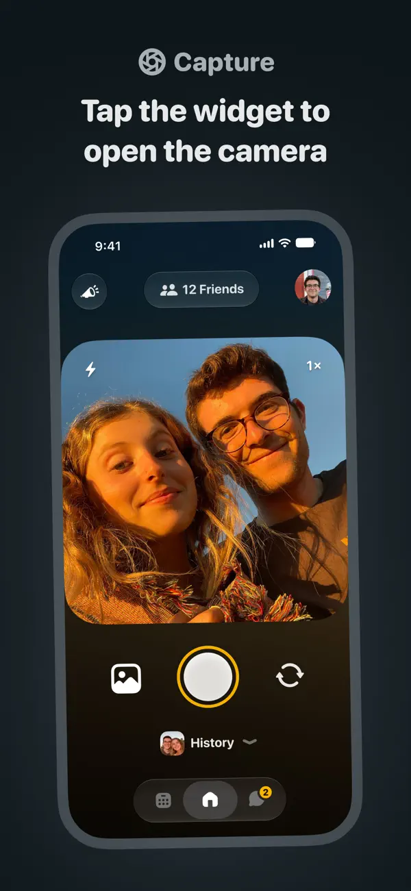
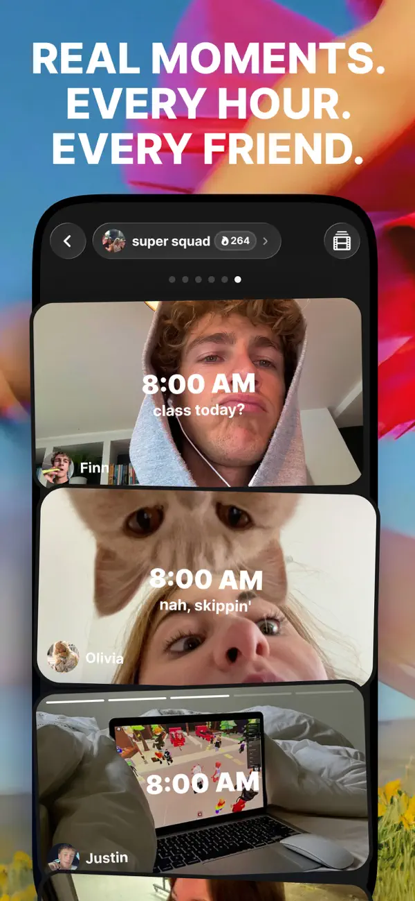

# Locket / Yope UI 风格与截图参考

采集日期：2026-10-27（Asia/Shanghai）。本目录收录 **13 张官方 iPhone 宣传截图 + 2 张商店来源页面截屏**，配合逐屏分析与 Squadly 适配建议。

优先查看 [可视化图集](index.html)，或分别阅读 [Locket UI 拆解](locket-ui.md)、[Yope UI 拆解](yope-ui.md)。每张图片的原始 URL、场景、采集日期和 SHA-256 见 [截图目录](screenshot-catalog.md) 与 [机器可读来源清单](sources.json)。

## 先看两种风格

| Locket：克制的照片相机 | Yope：活泼的小圈子照片空间 |
| --- | --- |
|  |  |
| 深色界面、白色操作图标、黄色强调、大圆角取景框；视觉注意力集中在拍照。 | 深色内容底、堆叠照片、时间叠字、小组胶囊；个性化和贴纸更活跃。 |

以上为对图片的视觉观察；不能据此断言所有页面、版本和系统均使用相同主题。[Locket 官方商店](https://apps.apple.com/us/app/locket-widget/id1600525061)、[Yope 官方商店](https://apps.apple.com/us/app/yope-friends-only-photos/id1600195477)

## 风格对照与 Squadly 借鉴

| 维度 | Locket | Yope | Squadly 建议 |
| --- | --- | --- | --- |
| 视觉重心 | 单张照片、相机和桌面组件 | 小组照片序列、照片聊天、个性资料与拼贴 | 学 Locket 的拍摄焦点，学 Yope 的小队照片连续性 |
| 配色关系 | 深色中性底 + 黄点缀；照片本身保留色彩 | 深色内容底 + 亮色局部操作；资料页/回顾更多彩 | 保留现有橙色 Token；照片页可以探索中性深底，不整套换黄/荧光色 |
| 形状语言 | 大圆角矩形照片、圆形拍摄控件、胶囊筛选 | 圆角照片、胶囊小组标题、贴纸与抠像 | 固定照片容器与明确操作区；装饰不遮挡受众和正文 |
| 导航 | 相机图中可见底部紧凑图标组，历史与聊天接近相机 | 部分图中可见多入口图标栏；不同页面结构有差异 | 不直接复制导航；既定四 Tab 不变，拍摄作为当前队上下文操作 |
| 社交线索 | 头像、姓名、时间、轻回应 | 组名、作者、时间、连续记录与贴纸 | 队名常驻、回复关联清楚；不增加贡献排名 |
| 记忆呈现 | 历史单图与周照片堆叠 | 拼贴、抠像、时间标签 | 先做可读的照片网格/轮播；拼贴在回顾中可选 |

对照依据为本目录图片 L06/L08、Y01/Y02/Y04/Y05，编号见截图目录。建议是本次分析，不是竞品官方规范或对 Squadly 已批准的改版。

## 给 Squadly 的具体落点

1. **拍摄页**：顶部清楚展示「发到某小队」；中间只保留取景/照片；底部给拍摄或发送一个明确主操作。参考 L06 的聚焦程度，发送仍需主动确认。
2. **照片详情与回拍**：照片、作者、发布时间、原消息关联优先；文字和回拍在同一区域可达。参考 L04/L08，避免详情页变成新的功能菜单。
3. **小队照片墙**：从 Y01 学习小组身份与照片顺序；在现有“小队”入口呈现同源照片消息，不按推广海报的倾斜手机、满屏背景做业务布局。
4. **桌面组件**：参考 L02/L05 的一张图 + 少量身份线索。保留更新时间、隐藏预览和失效占位；Y03 的锁屏构图不等于已验证的跨平台实现能力。
5. **回顾**：参考 L03 的时间段与 Y04 的记忆氛围；先确保当前受众授权与删除一致性，再增加贴纸和拼贴。健康字段、私密资产、精确路线不进入普通照片预览。

现有设计基线见 [Squadly UI 规范](../ui-design-spec.md)，功能边界见 [照片三环 P0](../../product-design/竞品/squadly-photo-loop-p0-2026-10-27.md)。本轮只整理参考，没有修改 UI 规范或应用代码。

## 素材性质与使用边界

- 图片取自开发者提交的美区 App Store 宣传图，不是本次登录竞品后拍摄的完整操作记录。无 Android 实机截图；不可标为双平台效果一致。
- 官方图中的手机外框、倾斜透视、外层彩色背景、大标题和出框贴纸属于宣传构图；手机内的可见布局才是分析客户端 UI 的主要依据。
- 浏览器显示的商店版本为 Locket 2.70.0、Yope 1.230.0；**宣传图拍摄日期与对应 App 构建未知**。页面版本不能用来给宣传图标注精确版本。
- 竞品色值、字体、圆角和动效没有公开设计规范证据；文中近似颜色是视觉参考，不是官方 Token。静态图不能验证点击、动效、状态切换或无障碍表现。
- 官方图片保留原貌，未裁剪、修图或 AI 重绘。截图中的人物、文字、商标及第三方贴纸属于原素材；它们不是 Squadly 可直接复用的产品资产。

## 文件组织

```text
competitors/
  README.md                 对照结论与适配建议
  index.html                本地离线可浏览图集
  locket-ui.md              Locket 逐屏视觉分析
  yope-ui.md                Yope 逐屏视觉分析
  screenshot-catalog.md     图片编号、场景与来源链接
  sources.json              来源、尺寸、哈希与采集信息
  overview.jpg              图集首页预览
  screenshots/
    locket/                 8 张宣传截图 + 1 张来源页截屏
    yope/                   5 张宣传截图 + 1 张来源页截屏
```
