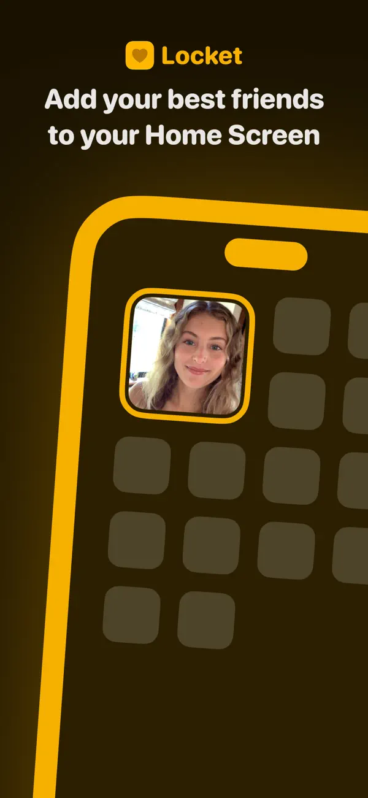
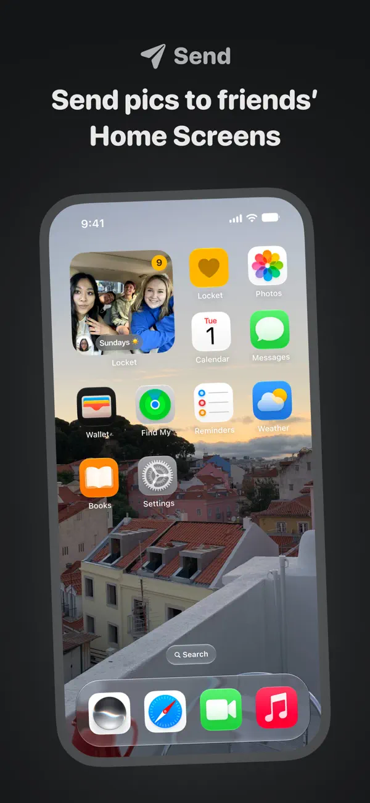
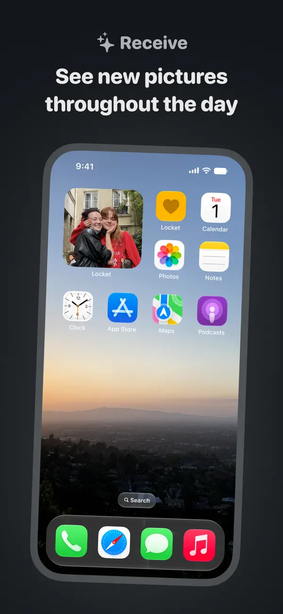
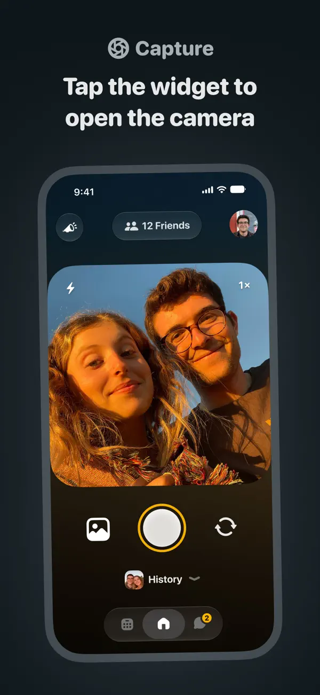
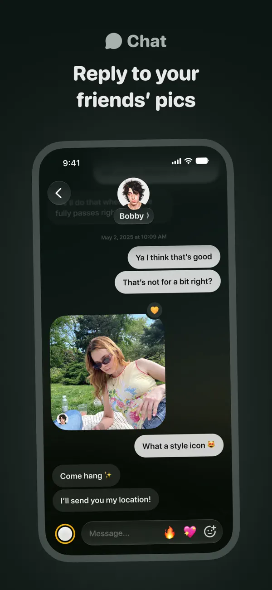
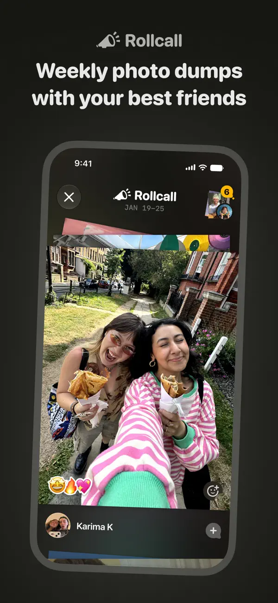
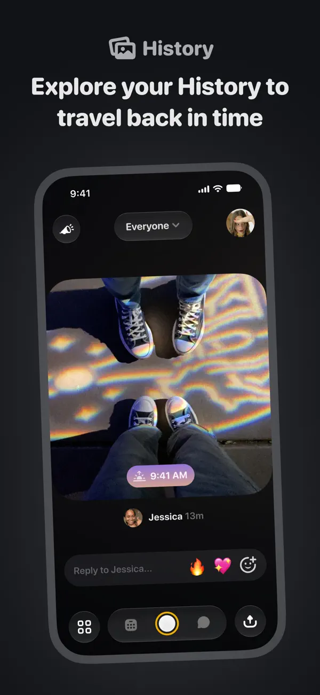
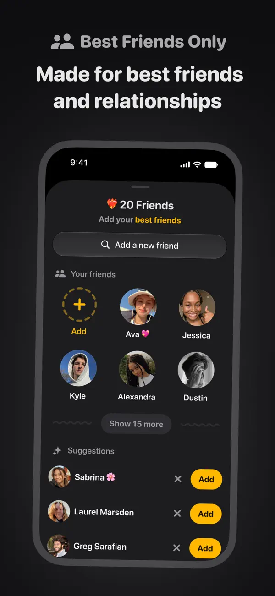

# Locket UI 风格拆解

采集：2026-10-27。来源：[美区官方 App Store](https://apps.apple.com/us/app/locket-widget/id1600525061)。以下 L01–L08 是官方宣传截图；未进行客户端实机登录。原图链接见 [截图目录](screenshot-catalog.md)。

视觉判断：**把照片放大，把操作收拢，用少量黄色让相机与亲密关系入口容易被找到**。下述判断只覆盖图中可见界面；深色宣传图不能证明应用没有浅色模式。

## 1. 桌面呈现：照片比品牌更重要（L01、L02、L05）

| L01 品牌/组件示意 | L02 桌面组件 | L05 接收后的桌面 |
| --- | --- | --- |
|  |  |  |

L01 是抽象手机示意，黄色轮廓属于品牌表达。L02/L05 更接近系统主屏场景：单张照片填满圆角组件，局部头像/标签提供来源线索。照片没有被长说明挤占；不用进入 App 也能识别朋友。

对 Squadly：组件只承载一张当前队照片、少量身份和更新时间；队名比新增品牌装饰更有用。不要把 L01 的粗黄色手机边框误认为真实组件必备边框；也不能从图中的数字角标反推已读或未读算法。

## 2. 相机：大取景框与明确的拍摄重心（L06）

可见结构从上到下是：关系胶囊与头像 → 大圆角取景框 → 相册/快门/翻转镜头 → 历史入口 → 紧凑图标栏。白色快门配黄色外圈最突出；闪光和倍率退到取景框角落，画面保留大面积原始照片色彩。

界面用空间和大小安排优先级，而不是每个操作都给实心品牌色按钮。图中的取景框接近方形，边角很圆；外层手机有透视，不能从图上量取真实 dp、边距或裁切比例。

对 Squadly：复制“当前小队 + 一张照片 + 一个主动作”的层级；沿用品牌橙的操作体系，别直接搬黄色。拍摄动作和发送动作需要分别清楚，单张静态图不证明 Locket 的确认步骤可以省略。

## 3. 照片聊天：关系在顶部，内容在中央（L04）

顶部居中的头像/姓名、两侧轻控件和照片消息形成简单层级。文字气泡根据发送方向左右区分；照片是较大的圆角块，头像贴近照片，底部输入栏保持低矮，相机和回应入口就近放置。

对 Squadly：照片、作者和回复动作应在一起；沿用原消息关联，不另开一套评论系统。可借鉴输入区的紧凑程度，但不能仅靠气泡颜色表达受众或权限，也不应把图中位置相关对话理解为产品必须新增位置分享。

## 4. 周回顾与历史：单张内容先于统计（L03、L08）

| L03 周照片回顾 | L08 照片历史 |
| --- | --- |
|  |  |

L03 通过时间范围、轻微叠放的相片和作者行表达“这一周”；L08 用单张大图、姓名/相对时间、回复栏表达历史。两者的主视觉都是照片，不是计数器或图表。圆角和深色容器让不同照片不必统一色调。

对 Squadly：先做好单图阅读与时间索引，再考虑拼贴。小队连续出现可作为次级状态，不应抢过照片。周回顾的外观与实际选图/解锁机制是两件事，后者见 [此前竞品证据](../../product-design/竞品/yope-locket-primary-evidence-2026-10-27.md)。

## 5. 成员面板：头像网格与一处主入口（L07）

面板使用圆形头像网格呈现已认识的人，添加操作有明确的黄色强调；上方标题、添加入口、已有好友与下方建议列表分层。大圆角面板和胶囊控件延续相机页的形状语言。

对 Squadly：可以借头像网格和邀请按钮层级；不复制建议陌生好友列表。邀请码与队长权限需要明确文案；“少量好友”不能用展示数量代替服务端 9 人上限校验。

## 6. 可抽取的视觉语言

| 元素 | 截图观察 | Squadly 应用建议 |
| --- | --- | --- |
| 背景 | 手机内多处为近黑/炭灰，内容色彩来自照片 | 作为照片相机/详情的深色探索，不强制全 App 变黑 |
| 强调色 | 黄色集中于快门圈、添加与局部标记 | 替换为既有品牌/操作橙 Token，并验证对比度 |
| 字体 | 手机内以无衬线为主；海报标题更粗、更圆润 | 不能确认字体名称；正文用系统中文，海报字体不搬到所有页面 |
| 容器 | 大圆角照片、圆形图标、胶囊筛选/输入栏 | 保持形状分工，不把设置和列表全部做成悬浮胶囊 |
| 图标 | 白/灰简洁图标与少量彩色 emoji | 基础操作稳定，emoji 只做内容/轻回应 |
| 层级 | 低文字密度、照片占主要面积 | 删除不必要说明，保留当前队、授权与错误状态 |

近似视觉色仅用于讨论：黄色可用 `#FFBF00` 一带、近黑可用 `#151515` 一带来描述；**未采集官方 Token，也不作为精确取色结果**。不从透视宣传图推导字号、触控热区、圆角半径和动画时长。

## 7. 参考时应保留的差异

- Locket 图中的底部图标组不是 Squadly 的导航方案；既定「会话 / 小队 / 计划 / 我的」继续有效。
- 组件照片曝光不是已读；作者专属明细仍按 Squadly 前台可见规则推进。
- 照片宽松构图不能以裁切掉重要内容为代价；中文长队名、大字体与不同头像数量仍要单独设计。
- 本组图片没有 loading、离线、撤回、权限拒绝和账号切换完整状态，不能直接作为实现验收全集。

[来源页面截屏](screenshots/locket/app-store-context.jpg) 保留商店与截图轮播上下文，网页中的 Apple 侧栏、评分和标题排版不属于 Locket 客户端 UI。
