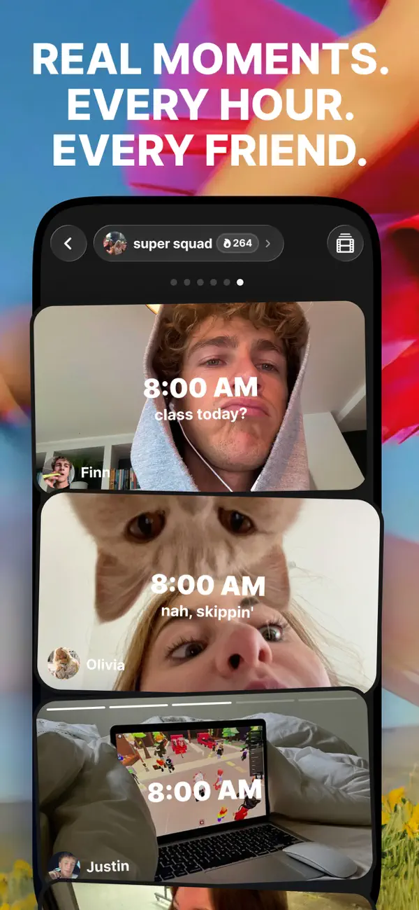
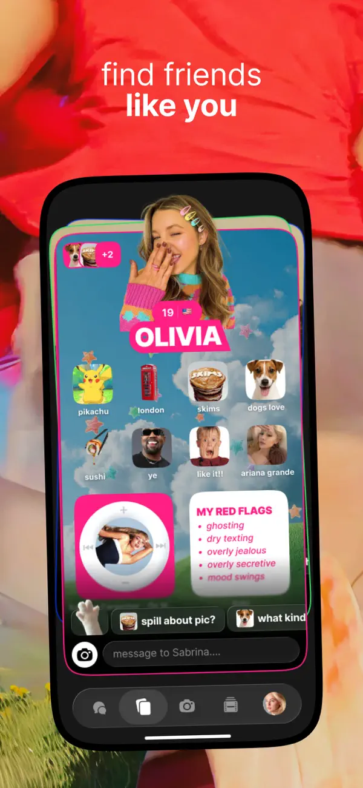
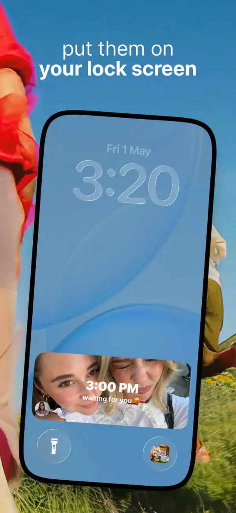
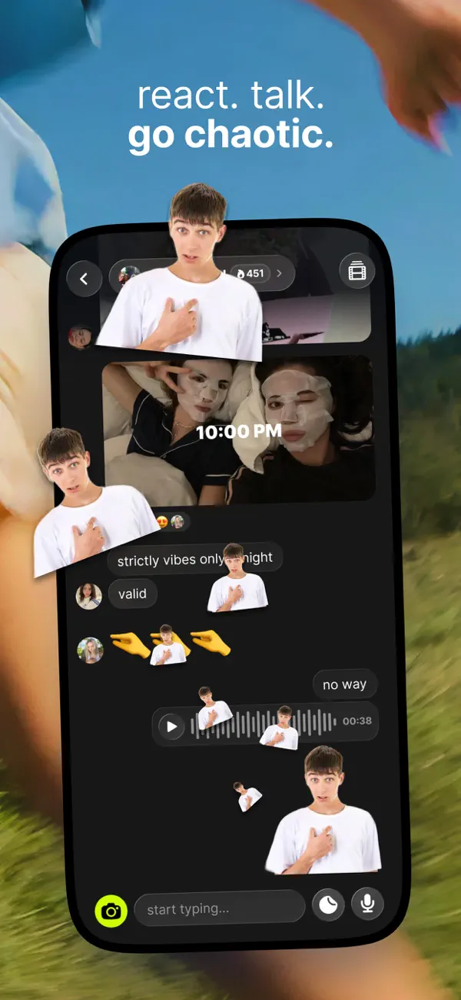

# Yope UI 风格拆解

采集：2026-10-27。来源：[美区官方 App Store](https://apps.apple.com/us/app/yope-friends-only-photos/id1600195477)。以下 Y01–Y05 是官方宣传截图；未进行客户端实机登录。原图链接见 [截图目录](screenshot-catalog.md)。

视觉判断：**深色照片容器保持内容清楚，亮色、贴纸与拼贴表达朋友间的个性**。不同截图的宣传程度较高，外层蓝天/草地/人物背景不属于 App 固定页面底图。

## 1. 小组照片序列：组名、时间与人（Y01）

顶部小组名胶囊含头像和连续记录视觉标记，两侧圆形返回/回顾类图标；下方有分页点，再往下是多张圆角照片。照片上叠加醒目的时间与短文字，作者头像/姓名靠近底部，照片之间的深色间隙保持顺序感。

对 Squadly：学“小队身份始终可见”和“照片形成连续交流”。时间叠字只在不遮主体时使用，长中文不直接放大铺满。图中的数字和分页点无法证明 streak 算法、真实组人数或翻页手势；这些需实测。

## 2. 个性资料：像朋友的拼贴名片（Y02）

人物抠像、醒目名字、主题背景、兴趣小图与不同尺寸卡片形成个人拼贴；下方快捷话题/输入区把资料与沟通衔接。亮粉色、细亮色边框和白色卡片制造活跃感，底部图标栏仍留在深色底上。

对 Squadly：可在小队封面或回顾中提供有限个性化，保持字段可读。P0 不扩成兴趣推荐、人格标签或陌生人匹配；截图上的“找朋友”宣传语也不足以定义后端发现机制。人物/贴纸只是竞品素材，不应移入自己的产品。

## 3. 锁屏：少量照片信息嵌入系统表面（Y03）

图中保留系统时间的留白，照片作为下方横向圆角块出现，照片内部有时间、短文字和小头像。内容层级浅，用户不必先读群摘要。外层被放大的斜手机和蓝色背景是海报构图。

对 Squadly：借鉴单图和身份线索，不直接承诺同样大小、位置和系统承载方式。静态宣传图无法判断它使用何种锁屏 API、系统版本或刷新策略，更不能证明 Android 与 iOS 等价。首轮桌面组件与后续锁屏方案分别验收。

## 4. 回顾：照片变成共同记忆，而非报表（Y04）

照片与抠像相互叠放，搭配蝴蝶结、星形等贴纸、时间标签和底部分享按钮；画面有明显的剪贴簿气质。该宣传图明确展示日/月回顾定位，但未验证生成方式、保存期、导出细节与付费范围。

对 Squadly：可把拼贴当作回顾的一种表现，不把全队照片墙也变成无序堆叠。先做图片不被遮挡、作者可追溯、受众一致的基础回顾；装饰可关闭，分享前重新确认。此图补充了此前文本调研的回顾线索，不等于已经实测客户端完整规格。

## 5. 照片聊天：回应也能是视觉内容（Y05）

照片在上，下面连接文字气泡、头像、emoji、贴纸与语音条；输入区左侧是显眼的亮黄绿色相机入口。深色底保留连续对话的结构，人物抠像跨出气泡或手机边界则强化宣传效果。

对 Squadly：优先借“在照片旁就能回应”和“相机操作容易发现”。P0 做文字与照片回拍即可；语音、抠像与动效不必跟进。图中大量人物贴纸是静态展示，不能据此宣称实机存在同款动画或每个出框效果都是界面元素。

## 6. 可抽取的视觉语言

| 元素 | 截图观察 | Squadly 应用建议 |
| --- | --- | --- |
| 内容底色 | 多张手机内界面使用近黑/深灰，弱化外围 | 照片场景可探索深底；管理、计划和表单沿用既有基线 |
| 强调色 | Y05 相机用亮黄绿色，Y02 资料用亮粉和细彩边 | 现有橙色保持主操作；个性颜色仅用于可选封面/装饰 |
| 字体层级 | 大时间/名字、短文字、作者小标签 | 中文控制行数，字号可随无障碍设置放大，不复制英文大写排版 |
| 内容容器 | 圆角照片连续堆叠；资料/回顾允许不同形状 | 照片墙保持规则网格，回顾再允许可选拼贴 |
| 身份线索 | 小组胶囊、头像、名字、时间在内容附近 | 显示当前队和真实受众，不仅靠背景色区分不同队 |
| 互动装饰 | emoji、贴纸、人物抠像密度较高 | 做次级/可选装饰，不干扰拍摄、撤回和授权确认 |

用于讨论的近似视觉色：亮黄绿色可用 `#D6FF00` 一带、粉色可用 `#FF2790` 一带、深色可用 `#171717` 一带描述；**这些不是官方设计 Token，也没有精确取色声明**。蓝天/草地色主要来自海报和用户内容，不应升格为所有页面的固定底色。

## 7. 适合借鉴与应后置的内容

| 立即借鉴的信息层级 | 后续可探索 | 不直接复制 |
| --- | --- | --- |
| 小队名常驻、作者/时间贴近照片、回复入口就近、照片本身占主视觉 | 有限封面个性化、可选贴纸、回顾拼贴与视频 | 兴趣推荐入口、复杂个人名片、密集出框装饰、强制 streak 压力、未知的 AI 处理链路 |

Yope 的年轻感不是单纯荧光色，而是把真实人物和生活照片放在最前面。Squadly 可以借其亲密与松弛感，继续保留明确受众、中文可读性、无排行和 Material 3 的稳定操作语义。

[来源页面截屏](screenshots/yope/app-store-context.jpg) 用于确认这些图片来自官方商店轮播；商店顶部 App 图标、评分及 Apple 网页侧栏不属于 Yope 客户端布局。
