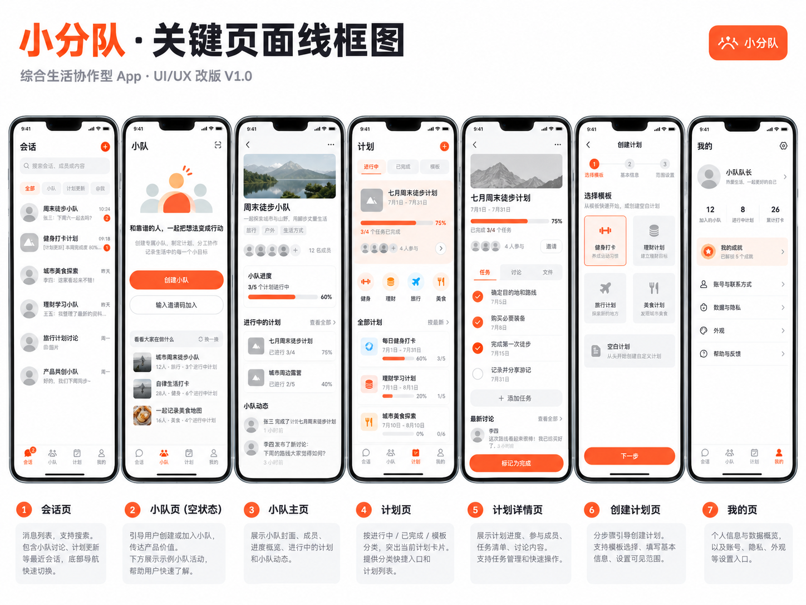
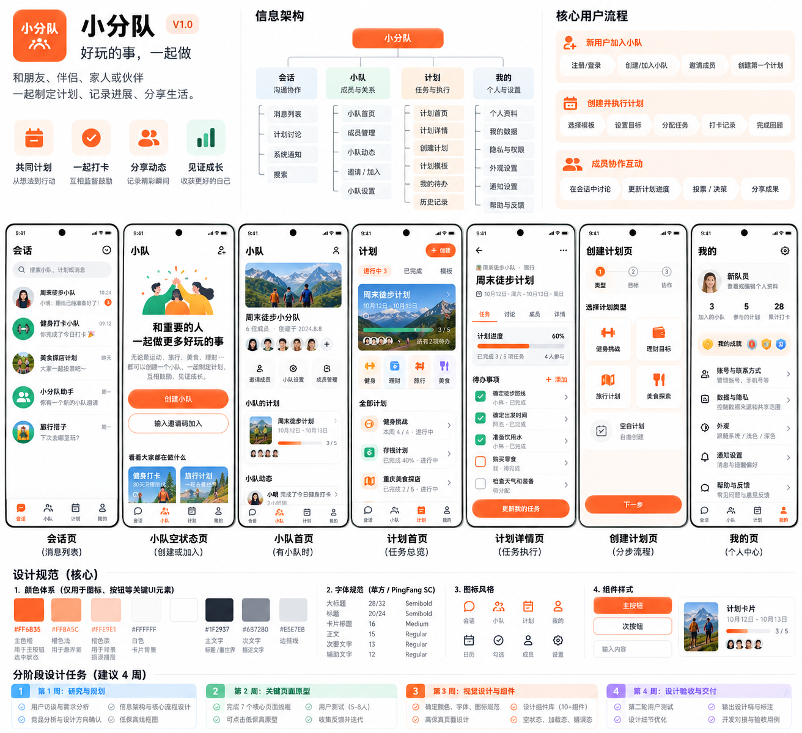
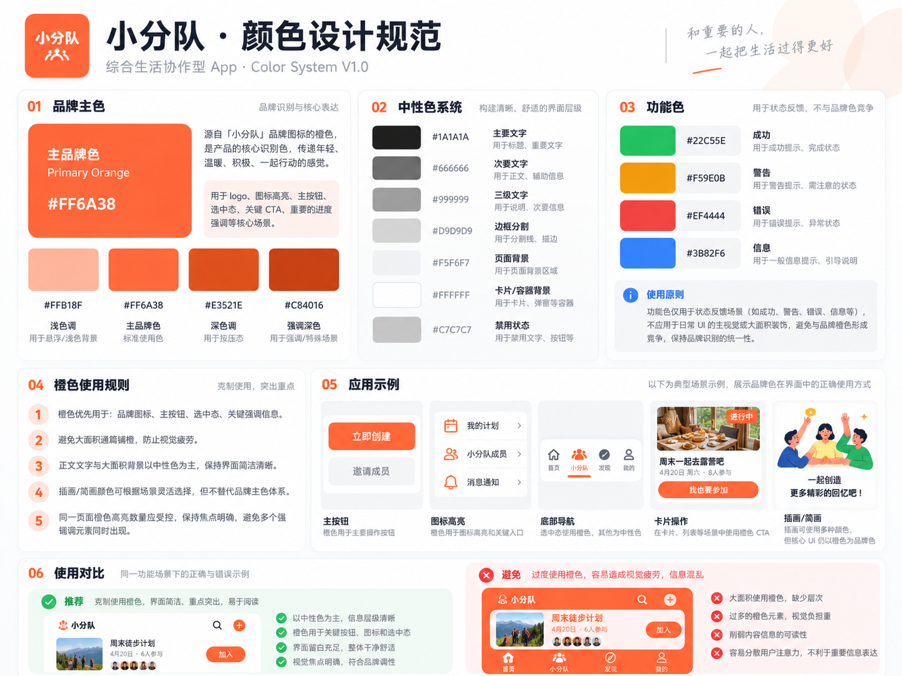
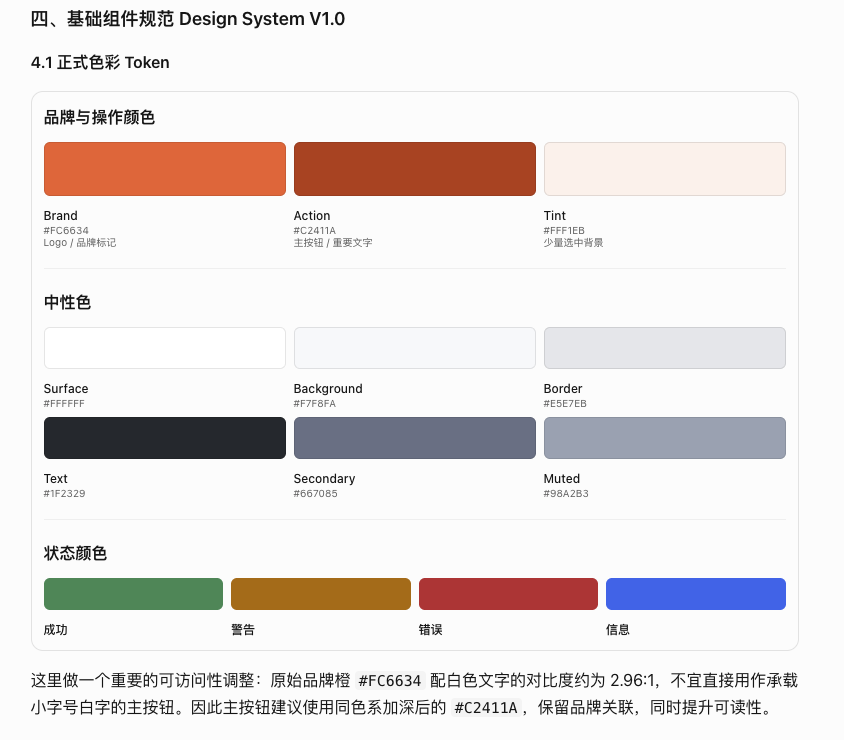

# Squadly UI/UX 设计与开发参考

| 字段 | 内容 |
| --- | --- |
| 文档状态 | 下一轮 UI 迭代基线 |
| 版本 | 1.2 |
| 更新日期 | 2026-10-27 |
| 适用平台 | iOS、Android |
| 技术基线 | Flutter + Material 3 |
| 主要参考 | V1.0 改版建议及 assets/images/ui 中的设计图 |

> 本文档用于指导下一轮 UI 设计与实现。产品结构和隐私决策以本文的决策记录为准；设计图中的示例文字、数据、头像、时间和进度均为原型素材，不代表真实业务数据。页面细节如需改变本文确认的导航、计划上下文或数据隐私边界，应先更新本文。

## 2026-10-27 照片三环增量

按用户授权优先实施 iOS，四 Tab 与正式橙色 Token 不变。相机/系统选图属于当前 Squad 上下文操作，顶部显示固定队名，准备成功后预览并明确点击“发到队名”；取消不发送，拒绝相机可改用系统选图。照片墙复用消息事实，组件显示不推进已读。原卡片与健康字段继续明确单次授权；净化照片允许私有上传的例外与规格见 [照片实施](../modules/photos/ios-photo-loop.md)。本增量不表示新页面、组件或后台链路已完成。

## 1. 产品与体验原则

小分队面向 2–9 人的邀请制亲密小圈子，帮助朋友、伴侣、家人和兴趣伙伴一起规划生活、完成目标、记录成果。品牌口号为「好玩的事，一起做」。

核心体验是：**会话沟通、小队协作、计划执行、个人管理**。健身、理财、旅行、美食是计划和协作的场景，不是彼此割裂的独立应用。

- **简洁、温暖、自然、可信赖**：以清晰信息层级、真实内容和轻量反馈建立亲密感。
- **品牌橙用于识别和关键交互**：背景、普通卡片和正文保持中性，不把所有 UI 染成橙色。
- **场景素材保留自身色彩**：运动插画、旅行照片、美食图片不加统一橙色滤镜。
- **协作边界清楚**：小队是协作空间，计划是执行对象，会话承载讨论，个人数据由用户控制。
- **状态完整**：设计空、加载、错误、离线、无权限、同步中和完成状态，不只交付成功态。

避免大面积品牌色背景、过度拟物、玻璃态和厚重投影；避免将所有信息装进相同样式的圆角卡片；隐私范围不能只靠颜色表达。

## 2. 设计参考

以下图片为 V1.0 视觉和结构参考。产品名称、导航结构和功能归属以本文已确认的决策为准；色值细节以第 4 节 Token 为准。

### 2.1 关键页面线框图

### 2.2 产品设计规范海报

### 2.3 橙色使用参考

### 2.4 正式色彩 Token 参考

海报中出现过不同探索色值，例如 #FF6B35、#FF6A38。为避免开发和设计各自取色，本轮统一使用第 4 节的正式色彩 Token。

## 3. 信息架构与导航

### 3.1 一级导航

应用使用四个一级目的地，顺序固定：

| 导航 | 用户目标 | 核心内容 |
| --- | --- | --- |
| 会话 | 讨论与沟通 | 最近会话、小队群聊、计划讨论、系统通知、搜索 |
| 小队 | 找到一起做事的人 | 小队列表与空状态、小队首页、成员与邀请、小队动态、小队管理 |
| 计划 | 推进具体事项 | 计划首页、创建计划、计划详情、任务与打卡、模板、完成回顾 |
| 我的 | 管理个人身份与数据 | 个人资料、参与记录、个人数据、共享权限、外观与设置 |

底部导航不设置单独的数据 Tab，也不设置独立的分享 Tab 或居中分享按钮。数据工坊、数据连接和个人素材从「我的」及具体分享流程进入；分享是一个动作，不是一级内容频道。

### 3.2 页面职责边界

1. **会话**承载沟通：小队消息、计划讨论和系统通知可从最近会话列表进入。
2. **小队**承载协作关系与共享空间：展示成员、管理入口、小队概况和小队动态，不复制完整计划任务管理。
3. **计划**承载目标和执行：展示计划状态、任务、进度、成员协作、模板和历史。
4. **我的**承载个人身份、偏好及个人数据入口。私密数据不能出现在小队动态或共享统计中。
5. 所有业务模块保持在当前 Squad 上下文中。个人计划可以设为「仅自己可见」，但仍关联当前小队；创建或加入小队是进入协作产品的前置流程。
6. 切换小队后，相关会话、成员、动态和小队计划同步切换上下文；必须让当前小队身份清楚可见。

### 3.3 核心用户路径

- **首次建立协作**：注册/登录 → 创建或加入小队 → 邀请成员 → 创建第一个计划。
- **执行计划**：打开计划 → 查看待办 → 完成任务 → 查看更新后的进度和协作反馈。
- **分享个人记录**：从个人素材或数据入口选择内容 → 编辑与预览 → 选择接收对象 → 明确确认发布 → 在小队会话或动态中查看已发布快照。

## 4. 视觉 Token

### 4.1 品牌、操作和中性色

| Token | 色值 | 用途 |
| --- | --- | --- |
| 品牌橙 Brand | #FC6634 | Logo、品牌标记、插画中的品牌元素 |
| 操作橙 Action | #C2411A | 白字主按钮、需要较高对比度的关键操作 |
| 品牌浅底 Tint | #FFF1EB | 少量选中背景、轻强调区域 |
| Surface | #FFFFFF | 卡片、弹层和主要内容表面 |
| Background | #F7F8FA | 页面背景 |
| Border | #E5E7EB | 分割线与控件边界 |
| Text Primary | #1F2329 | 标题与正文 |
| Text Secondary | #667085 | 次要说明 |
| Text Muted | #98A2B3 | 弱提示、时间与占位 |

品牌橙和操作橙承担不同任务：小面积品牌标记和选中强调使用品牌橙；白色小字放在品牌橙上时对比度不足，因此实心白字主按钮使用操作橙。小字号文字和图标应按最终背景验证对比度。

### 4.2 语义色

| Token | 浅色建议值 | 用途 |
| --- | --- | --- |
| Success | #198754 | 完成、成功 |
| Warning | #B76B00 | 需要注意、数据缺失 |
| Error | #C83232 | 失败和危险操作 |
| Info | #2563EB | 信息提示和引导 |

状态色表示语义，不以品牌橙替代。状态表达同时使用文字、图标或形状，不只依靠颜色。

### 4.3 深色模式

应用保留浅色与深色模式。现有线框图是浅色视觉稿，深色模式必须沿用相同的信息层级、导航和操作，不改变功能归属。

| Token | 深色建议值 |
| --- | --- |
| Background | #0F1115 |
| Surface | #171A20 |
| Surface Raised | #1D2128 |
| Surface Subtle | #232831 |
| Border | #2D333D |
| Text Primary | #F5F7FA |
| Text Secondary | #AAB1BC |
| Text Muted | #747D8A |
| Brand | #FF6A4A |
| Action | #FF8A5C |
| Brand Tint | #3A211C |

深色主题的操作按钮、语义色和文字组合须在组件落地时单独验证对比度；不得简单反转浅色图片或把纯黑作为大面积背景。

### 4.4 使用规则

- 橙色用于品牌标识、底部导航选中态、少量重点图标、主操作和关键进度提示。
- 普通卡片、页面背景、正文和长段文本使用中性色。
- 单个页面可出现多个品牌色交互点；以信息层级清楚、主次明确为准，不设机械面积百分比。
- 主要按钮用操作橙底白字；次要按钮使用中性底色和边框；禁用态使用中性灰。
- 完成、警告、失败分别使用语义色。插画与照片按场景自然配色。

## 5. 排版、间距与组件形态

### 5.1 排版与布局起点

| 元素 | 起始规格 |
| --- | --- |
| 页面水平内边距 | 16–20 dp |
| 间距阶梯 | 4 / 8 / 12 / 16 / 24 / 32 dp |
| 页面大标题 | 26–28 sp，Semibold |
| 分区标题 | 20 sp，Semibold |
| 卡片标题 | 16 sp，Medium |
| 正文 | 14–16 sp，Regular |
| 辅助文字 | 12–13 sp |
| 主按钮高度 | 48–52 dp |
| 卡片圆角 | 16 dp |
| 按钮圆角 | 12–14 dp |
| 常规图标 | 24 dp |
| 最小触控目标 | iOS 44 pt；Android 48 dp |

以上为设计起点，适配系统字体缩放、动态字体、长中文文本、小屏幕与平板布局；不要通过截断关键信息解决空间不足。

### 5.2 公共组件

| 组件 | 用途 | 关键状态 |
| --- | --- | --- |
| AppTopBar | 页面标题、返回、当前上下文和操作 | 默认、返回、更多、加载 |
| BottomNav | 四个一级目的地 | 选中、未选中、未读提醒 |
| PrimaryButton / SecondaryButton | 页面主要与次要操作 | 默认、按下、加载、禁用 |
| SquadCard / MemberAvatarGroup | 小队与成员摘要 | 正常、空、头像缺失、数量溢出 |
| ConversationRow | 最近会话摘要 | 默认、未读、置顶、消息预览 |
| MessageBubble | 文本消息与发送反馈 | 发送中、已发送、失败、已读状态 |
| PlanCard | 计划摘要与进度 | 进行中、已完成、逾期、无进度 |
| TaskRow | 任务与快速完成操作 | 待完成、完成、同步中、失败 |
| ProgressIndicator | 目标或计划进度 | 0–100%、无任务、加载 |
| EmptyState | 无小队、无计划、无消息等空状态 | 插画/图标、简短说明、主要 CTA |
| PrivacySelector | 私密、当前小队或指定成员范围 | 未选择、已选择、确认前说明 |
| DataSourceBadge | 来源和演示数据标识 | 来源未知、演示、已连接、失效 |

优先复用 Material 3 组件和主题 Token；只有出现稳定的跨页面模式时再抽取公共组件。列表内容不需要逐项包成相同卡片。

## 6. 关键页面与实现要求

### 6.1 页面清单

| ID | 页面 | 信息层级 | 首要操作 | 优先级 |
| --- | --- | --- | --- | --- |
| S01 | 会话 | 标题、搜索、消息分类、最近会话 | 打开讨论 | P1 |
| S02 | 小队空状态 | 标题、插画、简短价值说明、创建/加入、场景预览 | 创建或加入小队 | P0 |
| S03 | 小队首页 | 小队信息、成员、共同计划摘要、最近动态 | 邀请成员/查看计划 | P1 |
| S04 | 计划首页 | 进行中/已完成/模板、重点计划、快捷分类、列表 | 创建或推进计划 | P0 |
| S05 | 计划详情 | 计划信息、进度、任务/讨论/成员、待办 | 完成任务 | P0 |
| S06 | 创建计划 | 类型、目标信息、协作范围 | 保存计划 | P0 |
| S07 | 我的 | 个人资料、参与记录、数据与隐私、设置 | 管理个人数据 | P1 |

### 6.2 会话

- 顶部依次提供「会话」标题、搜索和活动分类；列表展示最近沟通对象、消息摘要和时间。关键词匹配小队名、消息作者及摘要；活动筛选仅基于是否存在真实消息，不显示尚无数据支撑的未读或 @ 提醒分类。
- 小队群聊与计划讨论可区分来源，并可从计划详情进入对应讨论。
- 每个计划关联独立讨论串；讨论串仍归属于该计划的当前 Squad，并从计划详情和会话列表双向进入。仅自己可见计划的讨论也仅创建者可访问。
- 聊天支持发送状态反馈，并对作者发送的消息提供**逐成员已读明细**；仅该消息作者可查看，接收方不能查看其他成员明细。已读状态应与成员身份关联、可被理解；不要仅用不带说明的头像或颜色表达。
- 单人和多人的消息行需适配长中文、未读提醒、空状态、加载和错误状态。
- 本轮不把语音/视频通话作为核心交付。

### 6.3 小队空状态与首页

- 空状态同时展示「创建小队」和「输入邀请码加入」两个明确入口，辅以简短价值文案和场景预览。
- 首次创建小队优先只要求必要信息；邀请和计划可在后续步骤完成。
- 有小队时展示小队名称/封面、成员与邀请入口、共同计划摘要和最近动态。
- 小队首页是团队概况与关系入口；完整任务操作留在计划页。
- 小队成员数限制为 2–9 人，加入必须邀请制。
- 小队概况、成员和分享的异步区域需要显示可读加载状态；加载失败提供明确原因与重试操作，不以无限旋转图代替状态反馈。

### 6.4 计划首页、详情与创建

- 计划首页先展示进行中事项，再展示已完成、模板、快捷分类和全部计划。
- 每个计划清楚标记归属范围（仅自己可见或小队协作）、业务类型、状态和进度。
- 计划详情提供编辑入口，可维护标题、描述、类型、可见范围和日期；编辑不得改变计划关联的小队或创建者。
- 计划详情可直接勾选任务，并可将任务分配给当前小队成员；任务行应显示负责人和截止日期。成员、讨论和任务状态可通过清楚的分段导航查看。
- 进度若按完成任务数/总任务数计算，需显示计数；无任务或无数据时不得伪造进度。
- 创建计划支持健身、理财、旅行、美食模板及空白计划；采用分步流程，收集必要信息后再补充可选项。
- 计划始终关联当前小队上下文；「仅自己可见」控制可见范围，不解除小队关联。保存前明确说明谁能看到。
- 既有健身与旅行计划迁移/映射到统一计划模型，保留原记录、标识、业务字段、状态和 Squad 归属；迁移后计划 Tab 是统一入口，新建/编辑不得再产生无法关联到统一计划的 legacy 计划。

### 6.5 我的与个人数据

- 我的页包括头像/昵称、参与记录（有真实数据时）、数据与隐私、外观、通知、帮助和退出入口。
- 使用帮助从「我的」进入，以可展开的常见问题说明邀请制小队、仅自己可见计划仍归属当前小队、单次分享、演示数据标识和资产隐私规则；说明必须与实际功能一致，不虚构健康服务已连接状态或客服渠道。
- 数据工坊、数据连接和个人素材从「我的」或具体分享流程进入，不新增数据一级 Tab。
- 个人健康记录和个人资产默认本人可见；用户主动选择共享范围后，才可生成共享内容。
- 理财必须区分 PublicFund 与 PrivateAsset：PublicFund 为小队共享数据；PrivateAsset 只能本人查看，不能进入小队动态、会话卡片、分享素材、报表或排行。

## 7. 分享、健康数据与隐私

### 7.1 单次分享

1. 选择个人素材和要展示的指标。
2. 选择时间范围并编辑文字或卡片样式。
3. 选择接收对象：仅自己、当前小队或指定成员（只呈现当前功能实际支持的范围）。
4. 发布前预览数据来源、时间范围、内容和接收者。
5. 用户明确确认后发布当前快照。

分享是**单次发布**：发布后，源数据变化不会自动更新已分享内容；不提供持续同步到小队的授权模式。外部健康来源如尚未真实接入，必须明确标识为演示素材，不得宣称已授权或已同步。

### 7.2 权限与可见范围

- 锁形图标或明确文字表示仅自己可见。
- 成员头像组或文字表示指定成员可见。
- 小队图标或文字表示当前小队成员可见。
- 分享确认页必须清楚显示接收者和发布内容。
- 发布确认绑定预览时的账号、小队、素材及接收成员；任一上下文失效时隐藏旧预览，要求重新选择并确认。账号或小队切换后清空分享草稿与受众选择；已打开的旧确认不能继续发布。
- 单次健康导入绑定发起时的账号；读取或选择记录期间切换账号时，隐藏旧选择内容并要求重新导入，不能把旧操作结果保存到新账号。
- 健康数据导入入口须先检查设备是否支持相应健康数据 provider；检查中禁用操作，不支持时明确提示，不能把“当前操作系统支持”误显示为“来源已可读取”。
- 颜色不能作为隐私边界的唯一提示；访问拒绝时不得泄露内容摘要或敏感值。
- 退出或切换账号时，关闭旧账号的临时详情页、表单与弹窗，清除临时操作提示并重置首页导航；同一账号的资料刷新保留当前导航和输入。
- 隐私范围变化、删除或撤回行为须提供明确反馈；具体历史卡片处理规则按产品能力实现，不得暗示未支持的撤回效果。

### 7.3 统计边界

- 可以呈现个人或小队共同目标的摘要与进度，数值需注明范围、单位和来源。
- 财务统计只允许共享公共基金与共享支出；个人私密资产仅本人可见。
- 本轮不设计小队成员数据排行或个人排名。
- 图表同屏建议不超过 4 个系列；提供文字摘要，不以红绿颜色单独表达好坏。

## 8. 页面状态与反馈

| 状态 | 设计与行为要求 |
| --- | --- |
| 首次使用/空状态 | 解释当前无内容的原因，提供一个主要 CTA；创建与加入小队可并列 |
| 加载中 | 使用骨架或轻量反馈，保持布局稳定 |
| 请求失败 | 简短说明并提供重试；保留用户已输入内容 |
| 网络异常 | 区分可离线操作和暂不可操作的动作 |
| 权限不足 | 说明无法访问，不返回敏感数据 |
| 操作提交中 | 防重复提交，显示进行中反馈 |
| 同步失败 | 显示失败原因和重试入口；不能显示为成功 |
| 已完成 | 清楚呈现结果、进度变化或下一步 |
| 消息已读 | 对每条消息提供逐成员已读状态，适配小队成员变动 |
| 分享确认 | 发布前展示内容快照、接收者与数据来源 |

动效保持轻量：页面切换约 180–240 ms；消息新到达自然插入，只有用户停留在列表底部时才自动跟随；打卡完成可有短暂语义反馈。尊重系统减少动态效果设置。

## 9. 可访问性与质量要求

- 正文与背景达到 WCAG AA 对比度目标；重要操作和状态需单独核验。
- 支持系统字体放大，关键流程在大字体下不截断。
- 图标按钮提供中文语义标签；所有交互控件有清晰焦点与按下状态。
- 图表提供可读文本摘要，屏幕阅读器可读出名称、数值、单位和时间范围。
- 不用颜色作为唯一状态或隐私提示。
- 深色模式避免纯白大面积高亮；深色按钮与语义色需实测。
- 对话和计划页面需兼容小屏幕、长昵称、长计划名和成员数量边界。

## 10. 本轮实现范围与交付

### P0：优先完成

- 小队空状态、创建与加入入口。
- 计划首页、创建计划、计划详情和任务执行。
- Squad 上下文及「仅自己可见」计划范围标记。
- 分享确认页面与单次快照语义。
- 私密资产不进入共享区域的展示边界。

### P1：完成关键路径

- 会话列表、小队首页、我的页面。
- 逐成员已读状态的视觉表达。
- 浅色与深色主题的核心页面覆盖。
- 关键页面的空、加载、失败和无权限状态。

### 本轮明确不包含

- 健康数据持续同步。
- 小队成员排行。
- 语音/视频通话和复杂多媒体消息。
- 尚未接入的数据源伪装成真实连接。

### 开发注意事项

- 一级导航固定为会话 / 小队 / 计划 / 我的；演示与 CloudBase 模式保持相同结构，不因后端模式改变导航。
- 在 Flutter 实现中使用仓库现有 Material 3 主题和 Riverpod 状态管理；页面通过对应 feature 的 provider/use case 获取数据。
- 本文是 UI 结构和体验基线，不替代 domain、repository、数据模型或后端权限设计。分享接收者、已读记录和计划可见范围需由现有功能能力支撑。
- 仅修改 UI 文档不要求运行代码生成；实现迭代时按仓库开发规范格式化、分析并测试。

### 实现状态与迭代边界

- 当前代码已统一四 Tab 导航，计划首页提供全部/状态/模板入口；健身、理财、旅行、美食与空白计划模板只预填类别和建议标题，由用户确认创建，不生成预置任务。计划创建、编辑、详情和任务执行已接入；进度由实际完成任务数/总任务数计算，无任务时显示空状态。
- 创建与编辑计划使用两步表单：先填写名称和类型，再设置描述、可见范围和日期；模板建议标题/类别保留，标题校验发生在进入协作设置前。
- 2026-10-19 Android 16 与 iPhone 17 Pro 集成冒烟覆盖计划创建和单次分享：仅自己可见计划在创建确认与详情页明确说明仍关联当前小队；分享流程要求先选受众、检查发布前快照说明，再明确确认。两端 Demo 用例通过；真实 CloudBase 授权与健康数据读取仍未在此流程中验证。
- 基础主题已按 Token 使用浅色页面背景 `#F7F8FA`、白色卡片 `#FFFFFF` 和边界色 `#E5E7EB`；深色模式保留对应暗色表面层级。主题单测、全量本地验证及 Android/iOS 导航冒烟已通过。
- 共享布局 Token 已覆盖常用间距、8/14/16/20/24 dp 圆角、48 dp 最小触控尺寸和 68 dp 底部导航高度，并应用于全局控件主题、计划页头部、小队引导及共享区块；窄屏和大字号空状态测试通过。2026-10-18 完整自动验证及 Android emulator、iPhone 17 simulator 导航冒烟均通过。
- 2026-10-18 依据正式色彩 Token，将全局筛选 Chip 与登录方式 SegmentedButton 的选中态统一为品牌浅底和操作色正文/图标，未选中项维持中性表面；浅/深主题通过主题回归测试，并验证选中态文字对比度达到 WCAG AA。iPhone 17 Pro 模拟器截图确认会话/计划筛选态及登录方式选择态符合规范。
- 摘要指标图标使用高对比度操作色，健身打卡完成图标使用语义成功色；浅/深主题的状态色对比度与关键组件颜色均有测试覆盖。登录主操作改为全宽 48 dp `FilledButton`，继承操作橙 Token；组件测试与 iPhone 17 Pro 模拟器截图确认白字/橙底主操作可辨。
- 演示和 CloudBase 小队页的卡片统一继承主题 16 dp 圆角，不再因后端模式产生不同卡片形状。
- 演示与 CloudBase 会话列表支持按小队名或最新消息摘要搜索，并按有消息/暂无消息筛选；无结果可清除条件，真实模式加载失败可重试。当前没有可靠未读数或 @ 提醒数据，因此不显示对应分类。
- 会话列表在搜索和分类控件前显示「会话」页标题，符合 S01 信息顺序。
- 真实模式小队首页为小队、成员和近期分享加载态提供文字标签；小队首屏失败显示网络提示和重试操作，避免只显示无说明的旋转图。
- 演示与真实模式共用无小队引导空状态，提供创建/加入入口和计划、会话、隐私边界预览；预览只说明产品能力，不显示虚构成员或活动记录。
- 真实模式小队页保留最近发布到会话的卡片分享，并新增独立的 Social 动态预览/完整列表；Social 使用单独的快照表和发布/Reaction RPC，不将普通消息伪装成动态。动态 repository、owner-only 素材读取和一次性快照发布已在本地接入；Social migration 已部署 staging，真实双账号权限待验收。
- 小米 HyperOS 与华为 Health Kit 官方资料显示存在运动数据接入路径，但需供应商侧服务开通/范围审批及用户授权；项目账号和审批资格尚未实测，故保持数据源不可用状态，不显示虚构的连接或同步。
- 演示与真实模式的数据工坊均从「我的」进入。真实模式素材受 owner-only 权限保护；iPhone 可手动授权并选择单条 Apple 健康运动记录，Android 可手动授权并选择单条 Health Connect 运动摘要，导入为个人素材，不建立持续连接或自动分享。Android 仅读取运动时段及对应距离，限系统默认近 30 天范围；不读取步数、卡路里或精确路线。小米/华为来源尚未接入，需明确显示不可用，不展示虚构同步。分享确认会展示接收者、内容和来源，并说明后续来源变化不会更新已发布快照。
- 计划列表和任务加载错误会展示安全映射后的权限、登录或网络提示；未知错误使用通用提示，Widget 测试覆盖计划加载重试及无权限状态。
- 会话列表、会话消息、计划列表和任务加载状态均提供可见中文说明及读屏语义，不只显示旋转图；专项测试覆盖会话列表加载态。
- 会话初次加载失败时展示独立错误和重试入口，不显示误导性的“还没有消息”；同步错误保留到后续请求成功，避免待发队列状态更新清除错误提示。
- 分享确认绑定预览时的账号、小队、素材和接收成员，健康单次导入绑定发起时的账号；上下文变化时隐藏失效预览/记录列表并拒绝旧回调。账号/小队变化清空分享草稿与受众选择，私人素材和来源按当前 owner 过滤；2026-10-20 新增 9 项回归，社交 33 项及全量 Flutter 308 项通过（2 项按配置跳过），静态分析通过。此验证不替代 staging/实体设备验收。
- 计划首页下拉刷新需等待计划列表和进度请求结束；请求失败也应结束刷新交互并显示已映射的错误状态，不能让刷新指示器提前消失。
- 计划始终关联当前 Squad；「仅自己可见」仅影响可见范围。既有健身/旅行计划已映射到统一计划入口；代码保留来源记录、来源 ID 和 Squad 归属，CloudBase 第 13 个 migration 在本地通过历史回填及旧表兼容同步验证，并于 2026-10-21 部署 staging，CLI 复核 13/13；真实账号权限待验收。
- 逐成员逐消息已读的模型、SQL 权限和真实模式 UI 已于 2026-10-22 完成本地实现；仅作者查看明细，不统计本次加入前的消息。第 14 个 migration 已于 2026-10-23 部署 staging，CLI 复核 14/14。44 项真实 A/B 核心 HTTP 权限和实际 SDK/repository 检查已通过；成员变更与真实设备仍待验收。常规构建默认开关关闭，R2 专用验收包已开启；不得用静态原型数据冒充真实已读状态。
- 设计稿中的内容、数字、进度与人物均为视觉参考。未接入真实数据的页面必须采用明确的空状态或演示标识。

## 11. 决策记录

| 日期 | 决策 | 状态 |
| --- | --- | --- |
| 2026-10-17 | 一级导航为会话 / 小队 / 计划 / 我的；不设数据或分享 Tab | 已确认 |
| 2026-10-17 | 数据工坊、数据连接与个人素材从我的及分享流程进入 | 已确认 |
| 2026-10-17 | 计划关联当前 Squad；允许仅自己可见 | 已确认 |
| 2026-10-17 | 品牌色 #FC6634、白字操作色 #C2411A、品牌浅底 #FFF1EB | 已确认 |
| 2026-10-17 | 会话和小队动态分属会话页与小队页 | 已确认 |
| 2026-10-17 | 显示逐成员已读状态 | 已确认 |
| 2026-10-17 | 健康数据分享为单次快照，不持续同步 | 已确认 |
| 2026-10-17 | 本轮不加入小队成员排行 | 已确认 |
| 既有决策 | 支持浅色和深色模式；当前参考图按浅色稿理解 | 保留 |
| 2026-10-20 | 既有健身/旅行计划迁移映射到统一计划模型，保留历史和 Squad 归属 | 已确认 |
| 2026-10-20 | 每个计划建立独立讨论串，关联当前 Squad，并可从计划详情和会话列表进入 | 已确认 |
| 2026-10-21 | 已读回执采用会话游标，普通会话与计划讨论分别隔离；逐成员已读仍待开发验收 | 已确认 |
| 2026-10-22 | 前台且最新消息可见才推进；本次加入前消息不计入；仅消息作者查看明细。当前本地实现通过，常规构建待云端验收后启用 | 已确认 |

---

**后续建议**：统一计划/计划讨论与逐成员已读 migration 均已部署 staging，下一步使用专用验收 APK 完成真实账号授权、已读可见性及跨账号隔离验证。Apple Health 和 Health Connect 仅支持用户手动的一次性记录导入，小米/华为尚未接入；不能改成持续同步分享。

## 12. 可靠性补充决策（2026-10-26）

- 共享基金：仅队长展示创建入口、管理元数据；成员仍可登记本人流水，余额由服务端流水维护，客户端不能直改余额。已部署并完成真实 A/B 基金复验，详见 [基金权限](../modules/finance/public-fund-permissions.md)。
- 本机聊天记录：长期保留，手动清理；退出清理此账号本机已发送记录，服务器和未发送内容保留。失去访问权仍保留已下载副本；联网明确无权限时显示权限错误，断网回退必须标识本机副本。入口「我的 → 清理本机聊天记录」，需确认，失败提示重试。
- 错误报告：默认关闭，需明确同意；授权按账号保存，退出/切换时撤销。只发送过滤后的 Dart 错误，不含聊天、健康、财务或凭据。没有 Sentry DSN 时不可开启；原生崩溃与云端收件另行验收。
- 2026-10-27：用户确认过期后先联网登录；新增「本机聊天记录」只读入口，SDK 已有会话未过期时可断网冷启动查看已下载记录，无需等待在线资料和列表。到期后立即隐藏并引导联网登录，记录保留；登录尝试期间暂停本机查看，账号切换清理原账号副本。详见 [冷启动规则与实现](../modules/conversation/offline-cold-start.md)。完整业务页面仍不提供离线模式，实体设备另行验收。
